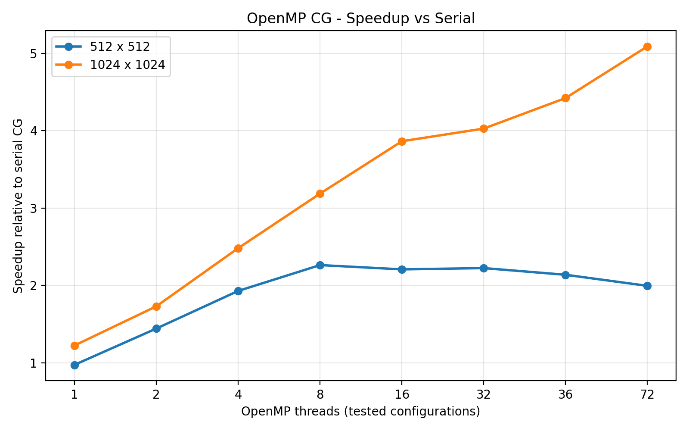
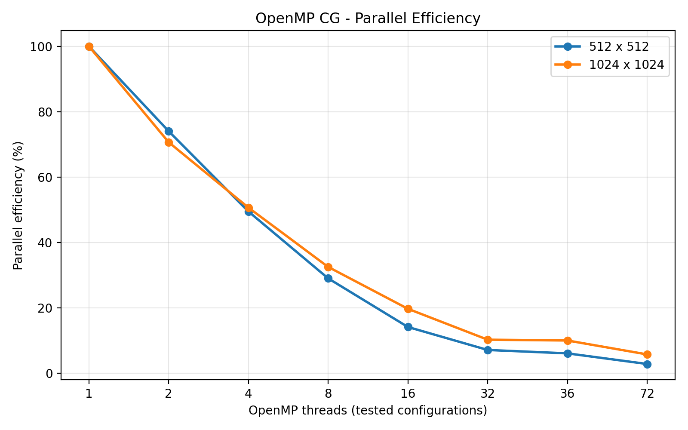
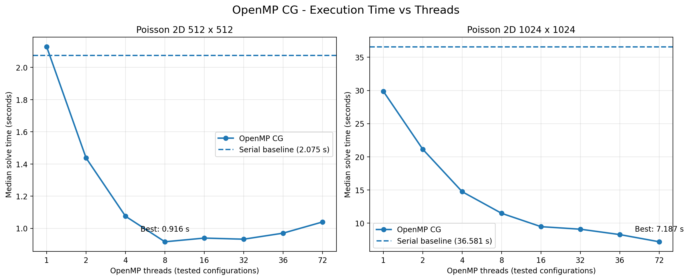
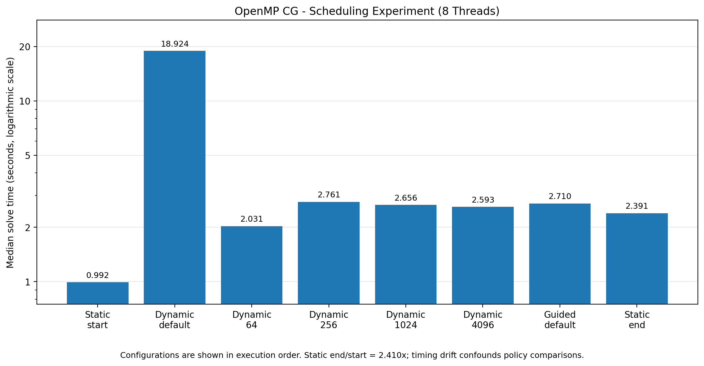

# DSA5208 — Parallel Conjugate Gradient Solver

NUS DSA5208 Group Project — parallel implementation and performance evaluation of the Conjugate Gradient (CG) method for sparse symmetric positive definite (SPD) linear systems.

## 1. Project Overview

This project investigates numerical correctness, convergence, runtime and scalability of Conjugate Gradient solvers using serial, shared-memory (OpenMP), distributed-memory (MPI) and hybrid parallel computing.

The implementations solve

\[
Ax=b,
\]

where \(A\) is a sparse SPD matrix. The serial implementation provides the tested reference solver and shared matrix infrastructure used to develop and evaluate the parallel versions.

**Status as of 21 October 2026:** Person A's **Task 1 (serial CG)** is implemented, tested and merged into `main`. **Task 2 (CPU OpenMP CG)** is implemented on `feat/openmp-cg`, validated on Vanda, and undergoing final PR preparation. The final Release CMake build passed **7/7 CTest tests** (PBS job `1471910`, CN-006). MPI and hybrid implementations are teammate responsibilities; their completion is not asserted here. GPU OpenMP offloading has been proposed as an optional follow-on but is not implemented in this CPU branch.

**Person A report:** [REPORT_TASK_A.md](REPORT_TASK_A.md) — implementation, correctness, measured scaling, scheduling, reproducibility and limitations. [Full benchmark tables](docs/task_a/benchmark_tables.md) and [experimental methodology](docs/task_a/benchmark_methodology.md) support that report.

## 2. Implementations

| Implementation | Parallelization | Status |
|---|---|---|
| Serial CG | Single CPU thread | **Completed; merged into `main`; numerical validation and benchmarks passed** |
| CPU OpenMP CG | Shared-memory multithreading | **Implemented; 7/7 tests passed; scaling/scheduling results archived; PR pending** |
| MPI CG | Distributed-memory multiprocessing | Pending / team integration (Person B) |
| Hybrid CG | MPI + CPU OpenMP | Pending / team integration (Person C) |
| GPU CG | OpenMP target offloading | Optional extension; **not implemented** |

### Completed Task 1 capabilities

- **CSR sparse representation:** a shared `cg::CSRMatrix` (`rows`, `cols`, `row_ptr`, `col_idx`, `values`) with structural validation; double-precision numerical values.
- **Common numerical operations:** reusable CSR sparse matrix-vector product and operations needed by CG.
- **Serial CG solver:** starts at \(x_0=0\), exposes configurable relative tolerance and iteration limit, reports convergence, iteration count and verified true relative residual; includes numerical-breakdown checks and true-residual verification / restart handling.
- **Synthetic matrices:** reusable CSR generators for 2D five-point and 3D seven-point Poisson operators with Dirichlet-boundary stencils.
- **Real-world matrix import:** Matrix Market coordinate-real general/symmetric loader, 1-based to 0-based conversion, mirrored off-diagonal entries for symmetric input, duplicate-coordinate summation, sorted CSR construction and input validation.
- **Benchmark harness:** configurable untimed CG warmups (one by default), individually timed solver-only repetitions, immediate warm-up / per-run progress messages, numerical accuracy checks outside the timed region, and a CSV row per measured repetition.
- **Correctness and integration checks:** small CSR and CG cases, Poisson systems, benchmark CSV tests, Matrix Market loader fixtures, and full `thermal2` CSR validation.

### Task 2 CPU OpenMP capabilities (implemented on `feat/openmp-cg`)

- **Parallel CG solver:** shared-memory OpenMP variant using parallel CSR sparse matrix–vector multiplication, vector operations and dot-product reductions; configurable thread count.
- **Scheduling control:** `static`, `dynamic`, and `guided` scheduling, with optional chunk size; zero selects the implementation's default chunk behaviour.
- **Reusable benchmark harness:** configurable warmups and repetitions; solver-only `std::chrono::steady_clock` timing, convergence and solution-error checks outside timed calls; CSV writer with common serial columns plus `schedule` and `chunk_size`.
- **Validated workloads:** 2D Poisson 512×512 and 1024×1024, 3D Poisson 40³, and SuiteSparse `thermal2`; selected correctness table records **54/54** successful measured solves.
- **Strong scaling:** 512×512 best observed median **0.916491 s / 2.264× serial-relative speedup at 8 threads**; 1024×1024 best observed median **7.186726 s / 5.090× at 72 threads**. Both experiments used ten measurements after four warmups per configuration.
- **Automated tests:** final Vanda Release build passed **7/7 tests** on CN-006, PBS job `1471910`; the broader large-matrix benchmarks are additional evidence rather than CTest cases.

**Shared interfaces:** `cg::CSRMatrix`, `cg::csr_matvec`, `cg::make_poisson_2d`, `cg::make_poisson_3d` and `cg::load_matrix_market` can be reused by other solver implementations. For MPI, matrix partitioning and rank-wise distribution remain separate implementation work; every rank need not independently load the full matrix.

## 3. Team Responsibilities

| Member | Primary responsibility |
|---|---|
| Person A | Serial CG, CPU OpenMP CG, optional GPU OpenMP offloading |
| Person B | MPI CG and integration of the shared matrix-generation utilities |
| Person C | Hybrid MPI + OpenMP CG, independent benchmarking and GPU comparisons |

The original work split assigned shared Poisson generation to Person B. During Task 1, Person A implemented the shared Poisson generators and Matrix Market loader so that all solver implementations can use common inputs. Coordination and integration with Person B remain necessary.

All implementations should adhere to the common numerical specification and shared interfaces. See [Project Specification](docs/PROJECT_SPEC.md).

## 4. Numerical Specification and Correctness

The implemented Task 1 serial experiments use:

| Parameter | Value |
|---|---|
| Arithmetic | Double precision (`double`) |
| Storage | Compressed Sparse Row (CSR) |
| Matrix type | Square, intended SPD |
| Known exact solution | \(x_* = \mathbf{1}\) (all ones) |
| Constructed RHS | \(b = A x_*\) |
| Initial guess | \(x_0 = \mathbf{0}\) |
| Relative residual tolerance | `1e-8` |
| Maximum CG iterations | `10000` |
| Numerical outputs | Converged flag, iterations, true relative residual, relative solution error |

The **true relative residual** is evaluated against the original system:

\[
r_{\mathrm{true}}=b-Ax,\qquad
\rho=\frac{\|r_{\mathrm{true}}\|_2}{\|b\|_2}.
\]

The **relative solution error**, with the manufactured reference solution, is

\[
e_x=\frac{\|x-x_*\|_2}{\|x_*\|_2}.
\]

Residual and solution error are distinct: an error larger than the residual is not in itself evidence of an incorrect solver, especially for a matrix with nontrivial conditioning. Structural CSR validation and a successful CG run do **not** mathematically establish positive definiteness of an arbitrary imported matrix; SPD suitability is a dataset/algorithm assumption to verify for any new benchmark.

## 5. Benchmark Matrices and Dataset Reproduction

### Synthetic Poisson matrices

- **2D Poisson:** five-point stencil, diagonal `4`, neighboring off-diagonal `-1`; \(N=n^2\).
- **3D Poisson:** seven-point stencil, diagonal `6`, neighboring off-diagonal `-1`; \(N=n^3\).
- Both are generated directly in CSR and use the same exact-solution/RHS construction as `thermal2`.
- Cases with comparable unknown counts permit 2D-versus-3D comparisons; larger cases will support subsequent strong/weak scaling studies.

### Real-world matrix — SuiteSparse `Schmid/thermal2`

`thermal2` is an unstructured finite-element steady-state thermal problem. The original Matrix Market coefficient matrix has symmetric coordinate storage.

| Property | Verified value |
|---|---:|
| Matrix dimension | 1,228,045 × 1,228,045 |
| Stored entries in `thermal2.mtx` | 4,904,179 |
| Expanded CSR entries | 8,580,313 |
| Matrix Market header | `%%MatrixMarket matrix coordinate real symmetric` |
| Accompanying RHS | `thermal2_b.mtx`, `matrix array real general` |

**Dataset links**

- Official SuiteSparse collection page: https://sparse.tamu.edu/Schmid/thermal2
- **University of Florida alternative archive (successfully downloaded on Vanda on 19 October 2026):** https://www.cise.ufl.edu/research/sparse/MM/Schmid/thermal2.tar.gz

On 19 October 2026, the official SuiteSparse download endpoint returned `403 Forbidden`. The University of Florida archive returned `200 OK` (64,854,356 bytes) and was downloaded and integrity-checked successfully. Accessibility is not guaranteed indefinitely.

From the **repository root on Vanda**:

```bash
mkdir -p data/suitesparse
curl -fL --retry 3 \
  -o data/suitesparse/thermal2.tar.gz \
  https://www.cise.ufl.edu/research/sparse/MM/Schmid/thermal2.tar.gz

gzip -t data/suitesparse/thermal2.tar.gz
tar -xzf data/suitesparse/thermal2.tar.gz -C data/suitesparse

head -n 1 data/suitesparse/thermal2/thermal2.mtx
# %%MatrixMarket matrix coordinate real symmetric
```

Extracted files:

```text
data/suitesparse/thermal2/thermal2.mtx
data/suitesparse/thermal2/thermal2_b.mtx
```

Our CG benchmarks do **not** use the provided `thermal2_b.mtx`; they construct `b = A * ones` to know the exact solution. The loader reconstructs symmetric off-diagonal entries, sums duplicate coordinates and returns validated CSR storage.

Manual full-dataset integration test (on an allocated Vanda compute node):

```bash
./build/test_matrix_market data/suitesparse/thermal2/thermal2.mtx
```

**Observed:** `Rows: 1228045`, `Cols: 1228045`, `NNZ: 8580313`; validation passed. The command took **5.825 s elapsed** in the recorded run, including fixture checks, parsing and validation; this is **not** the serial CG solve time.

Downloaded archives and matrices remain excluded from Git (`data/*` in `.gitignore`).

## 6. Repository Structure

The common serial and CPU OpenMP paths include:

```text
conjugate-gradient/
├── CMakeLists.txt
├── README.md
├── REPORT_TASK_A.md                # Person A report and analysis
├── docs/
│   ├── PROJECT_SPEC.md
│   ├── ENVIRONMENT.md
│   └── task_a/
│       ├── benchmark_methodology.md
│       ├── benchmark_tables.md
│       ├── figures/                # Four report-ready charts
│       └── results/                # Selected consolidated CSVs
├── include/
│   ├── csr_matrix.hpp
│   ├── csr_ops.hpp
│   ├── cg_solver.hpp
│   ├── poisson.hpp
│   ├── matrix_market.hpp
│   ├── serial_benchmark.hpp
│   ├── openmp_ops.hpp
│   └── openmp_benchmark.hpp
├── src/
│   ├── common/                     # Matrix/vector utilities and loaders
│   ├── serial/                     # Serial solver and benchmarks
│   └── openmp/                     # CPU OpenMP solver and benchmarks
├── tests/                          # Seven CTest targets in verified build
├── scripts/vanda/                  # Reproducible PBS scaling jobs
├── data/                           # Downloaded matrices (ignored)
└── results/                        # Generated per-run CSVs (ignored by default)
```

MPI/hybrid directories may be added or updated independently by teammates. The `docs/task_a` report artifacts are selected documentation outputs, not a replacement for the complete local HPC archive.

### Relevant CMake targets

| Target | Purpose |
|---|---|
| `cg_ops`, `cg_poisson`, `cg_matrix_market` | Shared sparse operations, generators and Matrix Market loading |
| `cg_serial`, `cg_serial_benchmark`, `run_serial_benchmark` | Serial solver and benchmark CLI |
| `cg_openmp_ops`, `cg_openmp` | CPU OpenMP numerical operations and CG solver |
| `cg_openmp_benchmark`, `run_openmp_benchmark` | CPU OpenMP timing, CSV output and benchmark CLI |
| CTest targets | `csr_validation`, `csr_matvec`, `openmp_spmv`, `openmp_cg`, `serial_cg`, `serial_benchmark`, `matrix_market` |

## 7. Development Environment

Primary testing and benchmarking environment: **NUS Vanda HPC**.

| Component | Verified environment |
|---|---|
| C++ | C++17 |
| Compiler | GCC / GCCcore 13.2.0 |
| CMake module | `CMake/3.27.6-GCCcore-13.2.0` |
| CPU observed during performance investigation | Intel Xeon Platinum 8452Y (CN-016) |
| Shared-memory OpenMP | CPU solver built and validated on Vanda; 1–72-thread scaling measured |
| Open MPI | 4.1.8 (environment checked; solver pending) |
| NVIDIA GPU | A40 observed elsewhere on Vanda; GPU solver not implemented in this branch |
| NVIDIA HPC SDK | 24.5 (offload feasibility checked) |

The recorded serial benchmarks were executed on allocated compute nodes, including **CN-016** (performance diagnosis) and **CN-149** (`thermal2`). Avoid treating timings from different compute nodes and allocations as directly interchangeable.

For a CPU interactive job (when permitted by your Vanda allocation):

```bash
qsub -I -P personal-e1536052 -q interactive_cpu \
  -l select=1:ncpus=2:mem=4gb -l walltime=00:30:00
```

Load the module **on the compute node**, including when running an already compiled binary:

```bash
module load CMake/3.27.6-GCCcore-13.2.0
```

This also supplies the matching GCC runtime; running without it may produce a `GLIBCXX_3.4.32 not found` dynamic-library error. See [Vanda Environment](docs/ENVIRONMENT.md) for additional queue and module information.

## 8. Build, Test and Run

Run compilation and performance tests on an **allocated compute node**, not the login node. From the repository root:

```bash
module load CMake/3.27.6-GCCcore-13.2.0

# Release
cmake -S . -B build -DCMAKE_BUILD_TYPE=Release
cmake --build build -j 2
ctest --test-dir build --output-on-failure

# Optional Debug build
cmake -S . -B build-debug -DCMAKE_BUILD_TYPE=Debug
cmake --build build-debug -j 2
ctest --test-dir build-debug --output-on-failure
```

**Observed final verification (21 October 2026):** the synchronized Person A source passed a Vanda Release build and **7/7 CTest targets** on CN-006 (PBS job `1471910.stdct-mgmt-02`, exit 0). This confirms compilation and automated regression coverage; large Poisson and `thermal2` validation were measured separately.

### Reproduce synthetic benchmarks

```bash
mkdir -p results

./build/run_serial_benchmark 2d 64 5 results/serial_2d_64.csv
./build/run_serial_benchmark 3d 16 5 results/serial_3d_16.csv

# Larger examples (longer execution)
./build/run_serial_benchmark 2d 256 5 results/serial_2d_256.csv
./build/run_serial_benchmark 3d 40 5 results/serial_3d_40.csv
```

Usage:

```text
run_serial_benchmark <2d|3d|thermal2> <grid_size|matrix.mtx> <repeats> <output.csv> [warmups]
```

### Reproduce the `thermal2` benchmark

Download and extract the data as described in Section 5, then run:

```bash
./build/run_serial_benchmark \
  thermal2 \
  data/suitesparse/thermal2/thermal2.mtx \
  3 \
  results/serial_thermal2_3runs.csv
```

The runner prints warm-up and per-run progress messages. With the default single warmup, three measured `thermal2` runs execute four CG solves in total. The optional final CLI argument changes the warmup count; the primary scaling jobs used **four warmups**. The shell's overall elapsed time is **not** the solver-only baseline.

### Reproduce CPU OpenMP benchmarks

After the Release build, on an allocated Vanda compute node:

```bash
mkdir -p results
./build/run_openmp_benchmark 2d 512 8 static 0 10 results/openmp_2d512_t8.csv 4
./build/run_openmp_benchmark 2d 1024 72 static 0 10 results/openmp_2d1024_t72.csv 4
./build/run_openmp_benchmark 3d 40 4 static 0 3 results/openmp_3d40.csv 1
./build/run_openmp_benchmark thermal2 data/suitesparse/thermal2/thermal2.mtx 4 static 0 3 results/openmp_thermal2.csv 1
```

```text
run_openmp_benchmark <2d|3d|thermal2> <grid_size|matrix.mtx> <threads> <static|dynamic|guided> <chunk_size> <repeats> <output.csv> [warmups]
```

**Use PBS for multi-core compute and benchmarks.** The two published 72-core scaling protocols are [512×512 PBS script](scripts/vanda/benchmark_openmp_scaling_72.pbs) and [1024×1024 PBS script](scripts/vanda/benchmark_openmp_scaling_1024.pbs). Pre-existing results under `results/` can be overwritten by running those scripts; use a separate output directory for a new campaign.

## 9. Benchmarking Methodology and Task 1 Results

### 9.1 Timing and CSV protocol

The serial benchmark uses `std::chrono::steady_clock` around **only** `solve_serial_cg(A,b,options)`. OpenMP similarly times only `solve_openmp_cg(A,b,options,omp_options)`. Specifically:

1. Construct or load the matrix, validate CSR, and construct \(b=A\mathbf{1}\) **before** timing.
2. Perform configurable **untimed warm-up CG solves** and verify convergence (one by default, four in the controlled scaling jobs).
3. For each measured repetition, time the solver call alone and verify convergence.
4. Calculate relative solution error and write per-run records **outside** the timed section.
5. Report each warm-up / run transition immediately; progress printing is outside timed regions.

The common serial CSV header is:

```text
solver,matrix_name,n,nnz,ranks,threads,run_index,iterations,converged,solve_seconds,true_relative_residual,relative_solution_error
```

For serial CG, `ranks=1`, `threads=1`, and `converged=1` denotes success. OpenMP retains the first twelve columns and adds `schedule,chunk_size`. Retain each recorded repetition rather than reporting only a best run. Unless noted otherwise, historic values below are **exploratory Task 1 measurements** from Release builds on Vanda. Controlled 512² and 1024² serial references, measured in their corresponding OpenMP scaling jobs, appear in §9.5.

### 9.2 Synthetic Poisson results

| Matrix | N | NNZ | CG iterations | True relative residual | Median solve time (s) | Notes |
|---|---:|---:|---:|---:|---:|---|
| 2D Poisson, `n=64` | 4,096 | 20,224 | 122 | 8.71368e-9 | 0.00568559 | Initial 5-run dataset on CN-016; see CSV |
| 3D Poisson, `n=16` | 4,096 | 27,136 | 41 | 6.11714e-9 | 0.00238256 | Initial 5-run dataset on CN-016; see CSV |
| 2D Poisson, `n=256` | 65,536 | 326,656 | 454 | 9.91666e-9 | 0.237475 | Preliminary 5-run measurement |
| 3D Poisson, `n=40` | 64,000 | 438,400 | 101 | 8.83638e-9 | 0.0626236 | Preliminary 5-run measurement |
| 2D Poisson, `n=512` | 262,144 | 1,308,672 | 894 | 9.52607e-9 | **2.075069** | Controlled 10-run serial reference, CN-036, job 1471134; earlier anomalies discussed in §9.4 |
| 3D Poisson, `n=64` | 262,144 | 1,810,432 | 158 | 9.03206e-9 | 0.463947 | Preliminary 5-run measurement |

All listed solves reached the configured true relative residual tolerance. Timing comparisons should consider different iteration counts, sparsity, problem geometry and job conditions. The initial CSVs tracked for reproducibility are `results/serial_2d_64.csv` and `results/serial_3d_16.csv`. Larger-case results remain preliminary and may need controlled reruns.

A subsequent `2d 64` compatibility/progress check on **CN-149**, after Matrix Market support and progress output were added, also passed (122 iterations, residual `8.71368e-9`, two solve times `0.0064521 s` and `0.0064379 s`). These separate-node numbers should not replace the original CN-016 dataset.

### 9.3 Real-world `thermal2` results (CN-149)

The first verified real-world solve used \(N=1{,}228{,}045\), `NNZ=8580313`, \(b=A\mathbf{1}\), tolerance `1e-8`, maximum iterations `10000`, and one untimed warm-up.

| Run / statistic | Solve time (s) | Iterations | True relative residual | Relative solution error |
|---|---:|---:|---:|---:|
| Initial single measured run | 153.520213 | 4,333 | 9.8606e-9 | 4.4121e-7 |
| Repeated run 1 | 148.122 | 4,333 | 9.8606e-9 | 4.4121e-7 |
| Repeated run 2 | 150.226 | 4,333 | 9.8606e-9 | 4.4121e-7 |
| Repeated run 3 | 146.410 | 4,333 | 9.8606e-9 | 4.4121e-7 |
| **Three-run median** | **148.122** | — | — | — |

Three-run statistics: mean **148.253 s**, sample standard deviation **1.911 s**, coefficient of variation **1.29%** (rounded). All three runs had identical iteration counts and numerical metrics. The separate initial run is retained as a diagnostic reference and is **not** included in the three-run statistics.

The complete three-run command took **10 min 0.576 s elapsed**, because it included one warm-up and three measured solves, plus loading and other overhead. For future speedup, the preliminary serial reference is the **three-run median solver time, 148.122 s**, subject to repeating baseline measurements under a comparable allocation when parallel benchmarking begins.

Results file: `results/serial_thermal2_3runs.csv` (selected CSV staged for Git). The initial file `results/serial_thermal2_initial.csv` remains local/ignored unless explicitly added later.

### 9.4 Vanda performance variability investigation (CN-016)

A larger 2D Poisson `n=512` serial benchmark (262,144 unknowns, 894 CG iterations) showed a **repeatable fast-to-slow transition** during repeated solves:

- Early repetitions ran at approximately **2.1 s**, while later repetitions were approximately **4.6 s**, despite identical iteration counts, true residuals and solution errors.
- Restricting CPU affinity separately to **CPU 22** and **CPU 28** did **not** remove the transition. Migration between those two allocated CPUs is therefore unlikely to be the principal cause.
- A pinned-run shell measurement (`real=36.765 s`, `user=36.605 s`, `sys=0.032 s`) showed nearly continuous CPU time; sustained waiting to be scheduled was not supported as the main explanation.
- Processor frequency readings were not available through `lscpu` / `cpufreq` sysfs. `perf stat -I 1000 -e cycles:u,instructions:u,task-clock` was available with performance-counter permission level 2.
- In one slow-phase interval, counter-derived cycles per second remained around **3.16–3.18 billion**, while IPC fell from roughly **3.9** to **1.79** and retired instructions per second fell from approximately **12.2 billion** to **5.7 billion**. This identifies a strong decline in observed instruction throughput, not an obvious decline in measured cycles per second.
- A later cache-counter experiment **did not reproduce the slowdown**: all five measured runs remained about **2.05–2.12 s**, IPC stayed roughly **3.9–4.0**, and sampled generic cache-miss percentages rose from about **0.3–0.4%** early to about **1.4–1.8%** later without the earlier collapse in IPC.

**Interpretation and limitations:** the counters confirm two distinct performance regimes and a substantial IPC reduction in the slow regime. They **do not establish the root cause**. Shared-cache / memory interference, differences in hardware stalls, processor execution conditions and other node-level variability remain hypotheses. The counter-derived cycle rate is not a direct, definitive measure of CPU operating frequency; generic cache-miss counts cannot isolate all memory stalls. The later experiment shows that rising generic cache-miss percentages alone are insufficient to explain the slowdown. Do not claim that cache contention, throttling or thermal effects were proven.

**Benchmarking consequence:** do not cherry-pick the 2.1 s regime or report an unqualified median across strongly bimodal measurements as the final `n=512` baseline. The subsequent controlled 10-run serial reference **2.075069 s** was collected in the same 72-CPU PBS job as the 512² OpenMP series (CN-036, job `1471134`), and is the value used in the finalized scaling comparison (§9.5). This design reduces between-job confounding but does not eliminate shared-cluster variability.

### 9.5 Completed Task 2 OpenMP strong-scaling results (October 2026)

Results below are **medians of 10 measured solver-only runs, following four untimed warmups**, with static scheduling, 1 PBS node and 72 requested CPU cores. The 512² and 1024² cases were measured in separate jobs on **CN-036** (`1471134`) and **CN-015** (`1471153`) respectively. Both used GCC 13.2.0 Release with `-O3 -DNDEBUG`, `OMP_PROC_BIND=close`, `OMP_PLACES=cores`, and `OMP_DYNAMIC=FALSE`.

| Threads | 512² time (s) | 512² speedup / serial | 1024² time (s) | 1024² speedup / serial |
|---:|---:|---:|---:|---:|
| Serial | 2.0751 | 1.000× | 36.5815 | 1.000× |
| 1 | 2.1283 | 0.975× | 29.8673 | 1.225× |
| 2 | 1.4373 | 1.444× | 21.1335 | 1.731× |
| 4 | 1.0752 | 1.930× | 14.7371 | 2.482× |
| 8 | **0.9165** | **2.264×** | 11.4778 | 3.187× |
| 16 | 0.9395 | 2.209× | 9.4665 | 3.864× |
| 32 | 0.9325 | 2.225× | 9.0823 | 4.028× |
| 36 | 0.9702 | 2.139× | 8.2717 | 4.422× |
| 72 | 1.0397 | 1.996× | **7.1867** | **5.090×** |

Serial-relative speedup is `T_serial / T_OpenMP(p)`. Parallel efficiency is defined **relative to the OpenMP 1-thread baseline** as `[T_OpenMP(1)/T_OpenMP(p)]/p`, and reaches **2.84%** (512²) versus **5.77%** (1024²) at 72 threads. The 512² problem performed best at 8 threads; the larger 1024² problem continued improving through 72 threads. These are **observations on these two jobs, not universal optimum thread counts**.







### 9.6 Task 2 numerical validation and scheduling

The report's selected correctness dataset contains **54/54 converged measured solves**, spanning 2D Poisson, 3D Poisson 40³, and SuiteSparse `thermal2`. Serial and OpenMP `thermal2` used **4,333 and 4,331 iterations**, respectively; both met the target true relative residual tolerance `1e-8`. Small iteration differences can result from floating-point reduction order. A larger relative solution error than residual does not by itself imply a failed solve.

Scheduling experiments compared `static`, `dynamic` and `guided`, including dynamic chunks 64, 256, 1024 and 4096. All **140/140** measured scheduling runs converged. Default dynamic scheduling was substantially slower in these experiments, but the final experiment's repeated static baseline grew from **0.992 s** at the start to **2.391 s** at the end (**2.410×**); consequently **fine-grained comparisons are confounded by within-job drift** and must not be presented as definitive policy rankings.



See [Person A report](REPORT_TASK_A.md), [tables](docs/task_a/benchmark_tables.md), and [methodology](docs/task_a/benchmark_methodology.md) for complete values, convergence evidence, job identifiers and limitations. Raw 88 CSVs, 10 PBS scripts and 10 logs are preserved in a separate local archive rather than committed wholesale.

### 9.7 Team-wide parallel evaluation (forthcoming)

MPI and hybrid comparisons should use compatible matrices, numerical tolerance and timing boundaries. For MPI/hybrid timings, use the slowest rank's relevant solve elapsed time and account for MPI rank/thread allocations and communication. Further GPU offloading remains a separate optional investigation; **no GPU speedups are claimed here**.

## 10. Development Workflow

Development uses Git feature branches and pull requests:

1. Develop a scoped task on a feature branch.
2. Build on Vanda and run applicable correctness/integration tests.
3. Preserve representative benchmark CSVs and document reproducible commands.
4. Review source diff, documentation, numerical outputs and ignored artifacts.
5. Commit and push the branch, open a PR, and merge after team review.

Task 1 serial implementation is already merged into `main`. Task 2 CPU OpenMP implementation and pending benchmark additions are being finalized on **`feat/openmp-cg`**. This README/report bundle is prepared for that PR, but the new documentation is not described as merged until a teammate approves and merges it.

Git ignores build outputs, downloaded matrices (`data/*`) and generated benchmark results (`results/*`) by default. Select representative small CSVs for version control explicitly, for example:

```bash
git add -f -- results/serial_2d_64.csv results/serial_3d_16.csv results/serial_thermal2_3runs.csv
```

## 11. References

1. Hestenes, M. R., and Stiefel, E. (1952). *Methods of Conjugate Gradients for Solving Linear Systems.*
2. Barrett, R., et al. (1994). *Templates for the Solution of Linear Systems: Building Blocks for Iterative Methods.*
3. Shewchuk, J. R. (1994). *An Introduction to the Conjugate Gradient Method Without the Agonizing Pain.*
4. Saad, Y. (2003). *Iterative Methods for Sparse Linear Systems.*
5. Davis, T. A., and Hu, Y. (2011). *The University of Florida Sparse Matrix Collection.*
6. SuiteSparse Matrix Collection, `Schmid/thermal2`: https://sparse.tamu.edu/Schmid/thermal2

## 12. Current Project Status (21 October 2026)

| Workstream | Status / evidence |
|---|---|
| Task 0 — C++17/CMake/CSR foundation | Completed for serial and CPU OpenMP workflows |
| Task 1 — Serial CG and shared utilities | **Implemented and merged into `main`**; Poisson/`thermal2`, CSR and numerical tests verified |
| Task 2 — CPU OpenMP CG | **Implemented** on `feat/openmp-cg`; CSR SpMV, CG numerical operations and configurable scheduling |
| Task 2 benchmark interface | Serial-compatible CSV schema, configurable warmups, CLI for 2D/3D/`thermal2` |
| Task 2 numerical evidence | Selected cases **54/54 converged**, including 3D Poisson and `thermal2` |
| Task 2 scaling and scheduling | 512² and 1024² **180/180** strong-scaling measurements converged; scheduling **140/140** converged |
| Task 2 final build | **7/7 CTest tests passed** on CN-006, PBS job `1471910`, 21 Oct 2026 |
| Task 2 PR | Benchmark source and documentation being staged/reviewed; **not yet merged** |
| MPI / hybrid | Team integration handled separately; completion not verified by Person A evidence |
| OpenMP GPU offload | Suggested optional extension; **not implemented or benchmarked** in this branch |

Full Person A reporting and evidence: [REPORT_TASK_A.md](REPORT_TASK_A.md).

## 13. Suggestions for Further Investigation

These are **optional** beyond the core project scope:

1. **2D versus 3D Poisson:** compare sparsity, iterations and runtime at approximately equal numbers of unknowns.
2. **Matrix conditioning:** study how conditioning influences CG convergence and residual-versus-solution-error behavior.
3. **GMRES comparison:** compare convergence and computational expense against a non-CG iterative method, if time and project scope allow.

Prioritize completing the CPU OpenMP PR and integrating teammate MPI/hybrid results before undertaking these optional investigations. GPU offloading, if pursued, should be a separate branch with independently validated GPU hardware/compiler support and numerical correctness.
