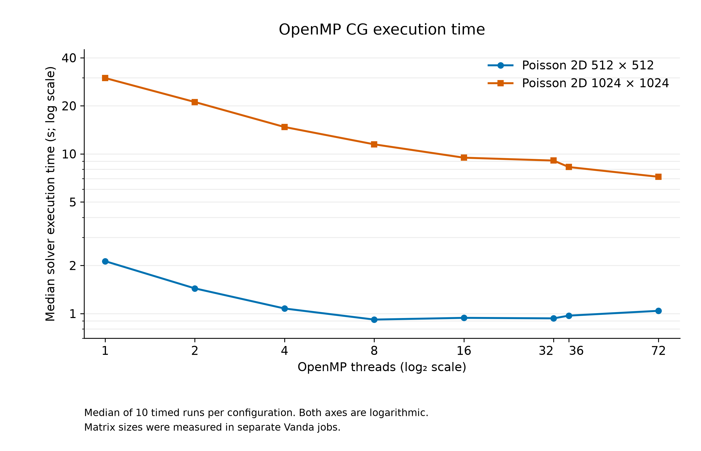
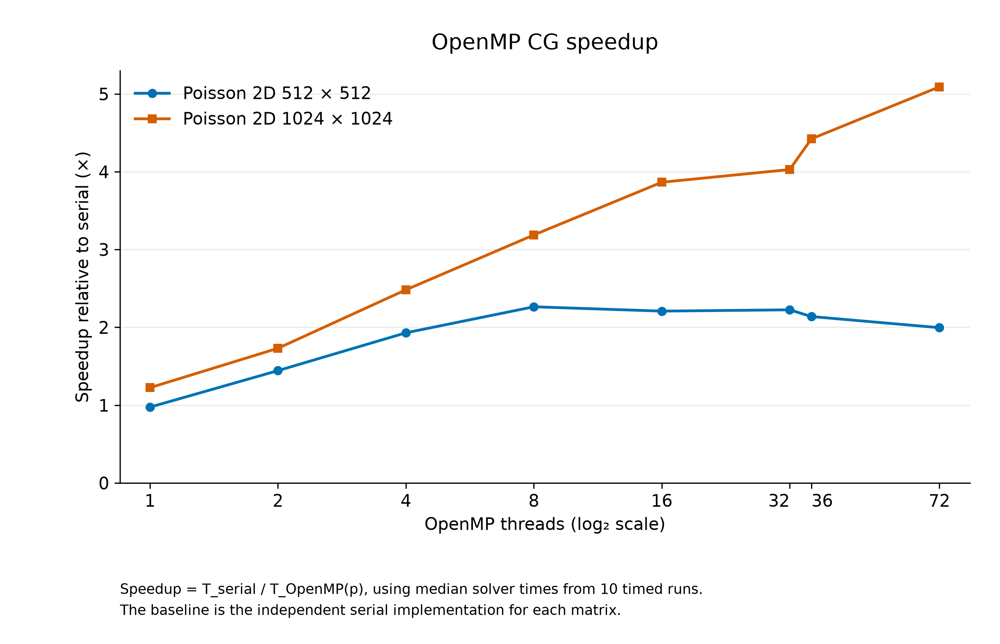
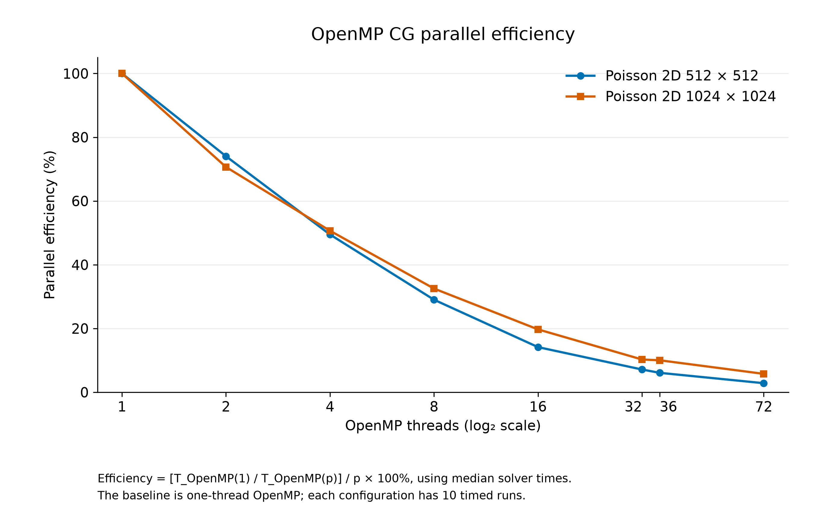
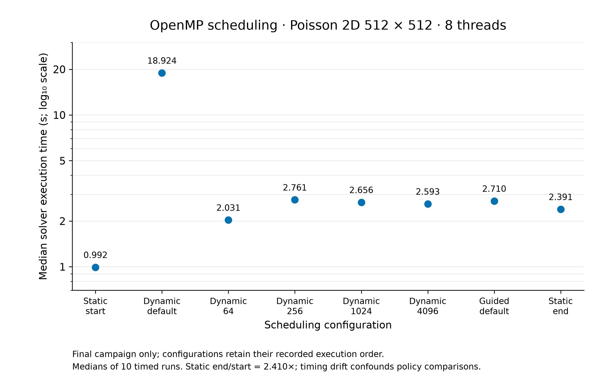
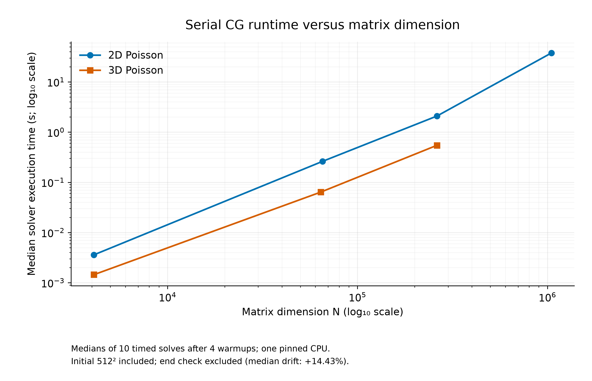
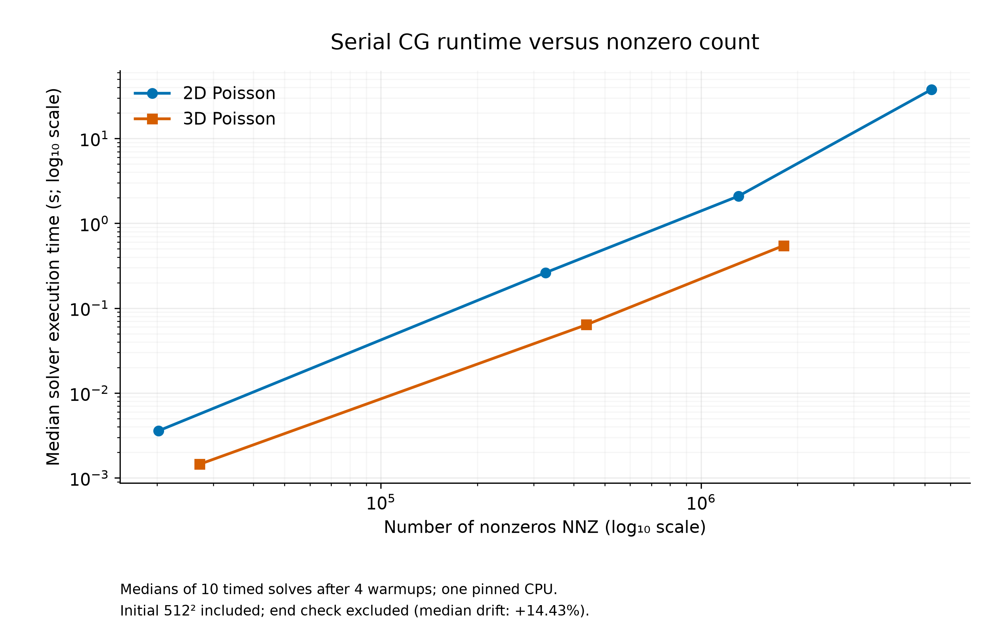

# DSA5208 — Person A Technical Report: Serial and CPU OpenMP Conjugate Gradient

- **Report scope:** Task 1 (serial CG and shared infrastructure) and Task 2 (CPU OpenMP CG)
- **Evaluation dates:** October 2026 OpenMP campaigns; 4 November 2026 controlled serial campaign
- **System:** NUS Vanda HPC cluster
- **Implementation:** C++17, CSR sparse matrices, double-precision CG, GCC 13.2.0 Release (`-O3 -DNDEBUG`)
**Status:** Serial and CPU OpenMP implementations are integrated into `main`. November serial evidence and revised documentation are prepared for review and are not yet committed. MPI, hybrid and GPU results are **outside the scope of this report**.

> **Evidence scope.** All numerical and performance results below are transcribed from the verified benchmark summaries and job outputs. The complete 88-CSV/10-PBS-script/10-log archive remains in the local `Vanda_Results_20261021` directory. The six revised PNG/SVG figures and source-derived supplemental tables are under [`docs/task_a/`](docs/task_a/). This report does not claim a successful GPU run or a completed MPI/hybrid integration.

The November serial campaign is archived separately under [`results/serial_scaling/20261104T022346Z_1517629.stdct-mgmt-02_EOF0kD/`](results/serial_scaling/20261104T022346Z_1517629.stdct-mgmt-02_EOF0kD/), without generated build artifacts.

## Abstract

We implemented and evaluated serial and CPU OpenMP versions of the Conjugate Gradient (CG) algorithm for sparse symmetric positive definite (SPD) linear systems. The serial work established a validated compressed sparse row (CSR) representation, sparse numerical utilities, 2D/3D Poisson generators, Matrix Market loading, a numerically checked CG solver and a reproducible benchmark interface. The OpenMP implementation parallelized the relevant sparse matrix–vector and vector operations, exposed configurable thread counts and scheduling policies, and used solver-only wall-clock timing with identical numerical inputs. Vanda Release builds passed all **7/7 CTest targets**. The selected cross-solver numerical-validation cases achieved **54/54 converged measured runs**.

For 2D Poisson at 512×512, the fastest observed OpenMP configuration was **8 threads, 0.9165 s**, compared with **2.0751 s serial** (**2.264×** speedup). For 1024×1024, **72 threads, 7.1867 s** was fastest among tested configurations, compared with **36.5815 s serial** (**5.090×**). Parallel efficiency decreased as thread count increased, indicating diminishing returns. A separate scheduling study demonstrated a marked slowdown for default dynamic scheduling but also exposed **2.410× static-baseline drift** within the final job; precise cross-configuration scheduling rankings are therefore not warranted. Results establish a correctness-tested CPU baseline for subsequent MPI and hybrid comparisons, subject to consistent workload and measurement controls.

Across the three completed performance campaigns, **400/400 timed CG solves converged**: **180** in the earlier OpenMP strong-scaling campaigns (including their 20 serial-reference runs), **140** in OpenMP scheduling, and **80** in the new serial scaling campaign. They came from separate experiments and allocations. Warmups are excluded. The historical 54-run selected correctness table overlaps some scaling records and is not added to this total.

## 1. Objectives and contribution boundary

The Person A work addressed:

1. **Task 1 — reference serial implementation:** implement and verify CG on reusable sparse data structures, establish matrix-generation and loading utilities, create correctness tests and collect serial timing evidence.
2. **Task 2 — CPU shared-memory parallelism:** implement CPU OpenMP CG and parallel sparse operations, expose scheduling/thread controls, verify numerical results, and evaluate strong scaling and runtime variability on Vanda.
3. **Reproducibility:** preserve per-run CSV records, PBS job specifications, automated-test evidence and report-ready analysis.

Work completed by teammates on MPI and hybrid MPI+OpenMP is not included here. The professor's suggestion to investigate OpenMP GPU target offloading is a potential *subsequent extension*, not a feature of the verified CPU implementation.

## 2. Numerical problem and CG methodology

We solve the sparse SPD linear system

\[
A x=b, \qquad A\in\mathbb{R}^{N\times N}.
\]

For controlled correctness tests, the benchmark constructs a known exact solution \(x_* = \mathbf{1}\), then forms \(b=A x_*\). CG is initialized at \(x_0=\mathbf{0}\), with target **true relative residual** \(10^{-8}\) and maximum **10,000 iterations**. The true relative residual and relative solution error are reported separately:

\[
\rho_{\mathrm{true}}=\frac{\|b-Ax\|_2}{\|b\|_2},
\qquad
\epsilon_x=\frac{\|x-x_*\|_2}{\|x_*\|_2}.
\]

The standard CG recurrence updates the residual, search direction and iterate using sparse matrix–vector products and dot products. With \(r_0=b-Ax_0\) and \(p_0=r_0\), each iteration computes \(q_k=A p_k\), \(\alpha_k=(r_k^T r_k)/(p_k^T q_k)\), \(x_{k+1}=x_k+\alpha_k p_k\), \(r_{k+1}=r_k-\alpha_k q_k\), \(\beta_k=(r_{k+1}^T r_{k+1})/(r_k^T r_k)\), and \(p_{k+1}=r_{k+1}+\beta_k p_k\). CG requires suitable SPD input; structural CSR validation alone does not prove positive definiteness for arbitrary imported matrices.

Small residuals and small solution errors are related but **not identical criteria**. In particular, a measured solution error larger than \(10^{-8}\) does not by itself violate a **residual** stopping threshold of \(10^{-8}\).

## 3. Software design and implementation

### 3.1 Task 1 — serial CG and reusable sparse infrastructure

The serial implementation comprises the following components:

| Component | Implemented role |
|---|---|
| `cg::CSRMatrix` | Compressed sparse row (`row_ptr`, `col_idx`, `values`), dimensions and structural validation |
| Shared CSR operations | Sparse matrix–vector multiplication and supporting vector operations |
| `solve_serial_cg` | Reference iterative CG solver, configured tolerance/iteration limit, convergence reporting and numerical checks |
| `make_poisson_2d`, `make_poisson_3d` | Synthetic SPD Poisson matrices using five-point and seven-point stencils |
| `load_matrix_market` | Coordinate-format Matrix Market reader with symmetric expansion and CSR construction |
| Serial benchmark harness | Untimed warmups, repeated solver-only timing, post-solve validation and per-run CSV records |

The **five-point 2D Poisson** operator uses a diagonal coefficient of 4 with nearest-neighbor \(-1\) entries; the **seven-point 3D** operator uses diagonal 6 and nearest-neighbor \(-1\) entries. For a grid dimension \(m\), the two generators produce \(N=m^2\) and \(N=m^3\) unknowns, respectively. The Matrix Market loader expands symmetric off-diagonal entries and combines duplicate coordinates when appropriate.

The initial serial benchmarking documented anomalous runtime regimes on shared-cluster resources rather than silently discarding them. Controlled serial baselines were subsequently collected alongside the OpenMP configurations in each of the two main scaling jobs.

### 3.2 Task 2 — CPU OpenMP CG

The CPU OpenMP version retains the same CSR data and CG numerical specification while parallelizing work suitable for shared memory:

- **CSR SpMV:** matrix rows are processed independently within a parallel loop; each row contributes to a distinct output entry.
- **Dot products:** parallel partial contributions are combined through OpenMP reductions. Floating-point summation order can differ from serial order.
- **Vector updates:** element-wise CG operations are distributed across threads.
- **Thread/scheduling options:** configurable thread count and `static`, `dynamic`, or `guided` scheduling; optional chunk size.

This is a shared-memory CPU implementation, not MPI and not OpenMP GPU target offloading. The dedicated benchmark library records thread count, schedule and chunk size alongside the serial-compatible numerical and performance columns.

### 3.3 Benchmark interfaces and CSV schema

```bash
# Serial benchmark; optional warmup count follows output filename
./build/run_serial_benchmark 2d 512 10 results/serial_2d512.csv 4

# CPU OpenMP benchmark
./build/run_openmp_benchmark 2d 512 8 static 0 10 results/openmp_2d512_t8.csv 4

# Real-world matrix (download separately; see repository README)
./build/run_openmp_benchmark thermal2 data/suitesparse/thermal2/thermal2.mtx 4 static 0 3 results/openmp_thermal2.csv 1
```

Serial rows include `solver,matrix_name,n,nnz,ranks,threads,run_index,iterations,converged,solve_seconds,true_relative_residual,relative_solution_error`. OpenMP appends `schedule,chunk_size`; `ranks=1` for both Person A implementations. The CSV writer uses 17-digit floating-point precision. CSV writing and post-solve error computation are outside measured intervals.

## 4. Experimental platform and protocol

### 4.1 Vanda configuration

| Setting | 512×512 scaling | 1024×1024 scaling |
|---|---|---|
| PBS job ID | `1471134.stdct-mgmt-02` | `1471153.stdct-mgmt-02` |
| Compute node | CN-036 | CN-015 |
| Queue | `auto` | `auto` |
| Allocation | 1 node, 72 requested CPU cores, 8 GB memory | 1 node, 72 requested CPU cores, 16 GB memory |
| Walltime request | 30 min | 60 min |
| Compiler/build | GCCcore 13.2.0, C++17, CMake Release, `-O3 -DNDEBUG` | Same |
| OpenMP configurations | 1, 2, 4, 8, 16, 32, 36, 72 threads | Same |
| OpenMP schedule | `static`, chunk 0 | `static`, chunk 0 |
| Warmups and repetitions | 4 warmups + 10 timed runs per configuration | Same |

The earlier OpenMP scaling jobs set:

```bash
OMP_PROC_BIND=close
OMP_PLACES=cores
OMP_DYNAMIC=FALSE
```

Both serial and OpenMP benchmark harnesses use **C++17 `std::chrono::steady_clock`**. Timing begins immediately before and ends immediately after the full CG solve call. Matrix generation/reading, right-hand-side construction, warmups, console progress, post-solve solution-error checks and CSV export are excluded. Internal CG computation and parallel synchronization are included. We report the **median** `solve_seconds` over measured repetitions, rather than a best single run.

The serial baseline is measured in the **same PBS job as its corresponding OpenMP scaling series**. The two matrix sizes used different compute nodes/jobs; comparisons across these sizes should emphasize *qualitative scaling behavior*, not identical hardware conditions. The job's tested configurations were run sequentially without randomization.

### 4.2 Workloads and numerical tests

| Workload | Unknowns \(N\) | Nonzeros \(NNZ\) | Role |
|---|---:|---:|---|
| Poisson 2D 512×512 | 262,144 | 1,308,672 | Main within-node strong-scaling experiment |
| Poisson 2D 1024×1024 | 1,048,576 | 5,238,784 | Larger strong-scaling experiment |
| Poisson 3D 40×40×40 | 64,000 | 438,400 | Additional numerical-validation case |
| SuiteSparse `Schmid/thermal2` | 1,228,045 | 8,580,313 | Real-world sparse-matrix numerical validation |

`thermal2.mtx` is loaded and symmetric storage is expanded into CSR. **This benchmark does not use the provided `thermal2_b.mtx` right-hand side**; it manufactures \(b=A\mathbf{1}\) to obtain a known exact solution. See [SuiteSparse collection entry](https://sparse.tamu.edu/Schmid/thermal2) and the repository README's data-reproduction instructions.

### 4.3 Performance definitions

Let \(T_s\) denote the median serial solve time, \(T_1\) the median *OpenMP one-thread* solve time, \(T_p\) the median OpenMP solve time at \(p\) threads. We report:

\[
S_{\mathrm{serial}}(p)=\frac{T_s}{T_p},\qquad
S_{\mathrm{OpenMP}}(p)=\frac{T_1}{T_p},\qquad
E_{\mathrm{OpenMP}}(p)=\frac{S_{\mathrm{OpenMP}}(p)}{p}\times100\%.
\]

**Two distinct baselines are intentional.** The earlier OpenMP campaign retains its original same-job serial references: **2.0750694645 s for 512²** (CN-036, job 1471134) and **36.5814764085 s for 1024²** (CN-015, job 1471153). The November serial medians are separate measurements and must not replace these references. Serial-relative speedup is `T_serial / T_OpenMP(p)`. OpenMP efficiency (%) is `T_OpenMP(1) / (p × T_OpenMP(p)) × 100`, using one-thread OpenMP medians **2.128281793 s** and **29.867328169 s**, respectively.

 The speedup figures/tables compare with serial CG, while efficiency is based on OpenMP one-thread execution to quantify scaling within the parallel implementation.

## 5. Results

### 5.1 Strong scaling: median solve time and serial-relative speedup

**Table 1.** Solver-only median runtime and speedup versus the matching serial CG measurement. Ten timed runs following four warmups per configuration.

| Threads | 512² median (s) | 512² speedup | 1024² median (s) | 1024² speedup |
|---:|---:|---:|---:|---:|
| Serial | 2.0751 | 1.000× | 36.5815 | 1.000× |
| 1 | 2.1283 | 0.975× | 29.8673 | 1.225× |
| 2 | 1.4373 | 1.444× | 21.1335 | 1.731× |
| 4 | 1.0752 | 1.930× | 14.7371 | 2.482× |
| **8** | **0.9165** | **2.264×** | 11.4778 | 3.187× |
| 16 | 0.9395 | 2.209× | 9.4665 | 3.864× |
| 32 | 0.9325 | 2.225× | 9.0823 | 4.028× |
| 36 | 0.9702 | 2.139× | 8.2717 | 4.422× |
| **72** | 1.0397 | 1.996× | **7.1867** | **5.090×** |



*Figure 1.* Median OpenMP solver time for the two matrix sizes, with numerical log₂ thread counts and log₁₀ seconds. Each point summarizes ten timed runs. This revised figure contains OpenMP series only; the serial references remain in Table 1.



*Figure 2.* Speedup relative to the original same-job independent serial implementation, with log₂ thread counts and a linear speedup axis. The separate November serial medians are not used.

The smaller workload performed best at **8 threads (0.916491 s)**. Using 72 threads instead took **1.039722 s**—approximately 13.4% longer than at 8 threads. The larger workload continued improving through **72 threads (7.186726 s)**, approximately 37.4% lower runtime than its 8-thread result (**11.477809 s**). These are *best observed configurations within the tested settings*, not assertions about other matrices or machines.

### 5.2 OpenMP parallel efficiency

**Table 2.** OpenMP-relative efficiency, computed using \(T_1/T_p/p\) rather than serial-relative speedup.

| Threads | 512² efficiency | 1024² efficiency |
|---:|---:|---:|
| 1 | 100.00% | 100.00% |
| 2 | 74.04% | 70.66% |
| 4 | 49.48% | 50.67% |
| 8 | 29.03% | 32.53% |
| 16 | 14.16% | 19.72% |
| 32 | 7.13% | 10.28% |
| 36 | 6.09% | 10.03% |
| 72 | 2.84% | 5.77% |



*Figure 3.* Efficiency uses one-thread OpenMP as its baseline, a log₂ thread axis and a linear percentage axis. Parallel efficiency decreases with added threads for both matrix sizes. At 72 threads the larger workload retains more efficiency (5.77% versus 2.84%), although both are far from ideal linear scaling.

The observations are consistent with fixed and thread-dependent overheads—such as thread synchronization and reductions—and potential memory-system limits becoming significant at high core counts. **The benchmark did not isolate or prove any individual bottleneck.** Additional profiling would be required for causal attribution.

### 5.3 Numerical correctness

**Table 3.** Maximum observed true relative residual and relative solution error within each selected solver/matrix configuration; all listed repetitions converged. The target stopping tolerance was a **true relative residual of \(10^{-8}\)**.

| Matrix | Solver | Threads | CG iterations | Max. true relative residual | Max. relative solution error | Converged |
|---|---|---:|---:|---:|---:|---:|
| Poisson 2D 512² | Serial | 1 | 894 | 9.526e-09 | 2.211e-08 | 10/10 |
| Poisson 2D 512² | OpenMP | 8 | 894 | 9.526e-09 | 2.211e-08 | 10/10 |
| Poisson 2D 1024² | Serial | 1 | 1,755 | 9.802e-09 | 4.819e-08 | 10/10 |
| Poisson 2D 1024² | OpenMP | 72 | 1,755 | 9.802e-09 | 4.819e-08 | 10/10 |
| Poisson 3D 40³ | Serial | 1 | 101 | 8.836e-09 | 3.877e-09 | 5/5 |
| Poisson 3D 40³ | OpenMP | 4 | 101 | 8.836e-09 | 3.877e-09 | 3/3 |
| SuiteSparse thermal2 | Serial | 1 | 4,333 | 9.861e-09 | 4.412e-07 | 3/3 |
| SuiteSparse thermal2 | OpenMP | 4 | 4,331 | 9.974e-09 | 4.432e-07 | 3/3 |

Across these selected validation configurations, **54/54 measured runs converged**. Within the two main scaling campaigns, all **180/180 timed runs** also converged. For `thermal2`, the serial and OpenMP iteration counts differ by only two iterations and both satisfy the target residual criterion. Different floating-point reduction order is a *plausible* contributor to minor CG convergence-history differences, but is not independently demonstrated as the cause of the exact two-iteration difference. The approximate \(4.4\times10^{-7}\) relative solution errors should not be mistaken for the convergence stopping criterion.

The 3D and `thermal2` validation data confirm numerical behavior, but do **not** establish controlled speedup for those matrices because the provided serial and OpenMP cases were collected in separate experiments and allocations.

### 5.4 Scheduling policy and chunk size

All scheduling experiments below use 2D Poisson 512×512 and **eight OpenMP threads**. They belong to **three distinct experiment groups**; timing levels across jobs are not automatically interchangeable.

**Table 4.** Median and range of observed solver runtimes by scheduling configuration; 10/10 measured runs converged for every row.

| Group | Scheduling configuration | Median (s) | Min (s) | Max (s) |
|---|---|---:|---:|---:|
| Initial policies | Static | 0.9861 | 0.9421 | 1.1651 |
| Initial policies | Dynamic default | 15.5717 | 15.2828 | 15.6243 |
| Initial policies | Guided default | 0.9991 | 0.9577 | 1.2052 |
| Separate dynamic-chunk job | Dynamic chunk 64 | 3.1496 | 3.0928 | 3.2506 |
| Separate dynamic-chunk job | Dynamic chunk 256 | 2.7785 | 2.7592 | 2.8231 |
| Separate dynamic-chunk job | Dynamic chunk 1024 | 2.6682 | 2.6271 | 2.7390 |
| Final policy/chunk job | Static (start) | 0.9920 | 0.9842 | 1.0076 |
| Final policy/chunk job | Dynamic default | 18.9238 | 18.8078 | 20.8426 |
| Final policy/chunk job | Dynamic chunk 64 | 2.0314 | 1.6419 | 2.2552 |
| Final policy/chunk job | Dynamic chunk 256 | 2.7606 | 1.4764 | 2.8287 |
| Final policy/chunk job | Dynamic chunk 1024 | 2.6564 | 2.5950 | 2.6802 |
| Final policy/chunk job | Dynamic chunk 4096 | 2.5925 | 2.4869 | 2.6415 |
| Final policy/chunk job | Guided default | 2.7099 | 2.6905 | 2.7818 |
| Final policy/chunk job | Static (end) | 2.3907 | 2.3370 | 2.4266 |



*Figure 4.* Final job's scheduling cases, in run order, displayed with categorical scheduling configurations and a **base-10 logarithmic time axis**. The repeated static baseline shifted from 0.991975 s to 2.390650 s, a **2.410× slowdown**. The plot demonstrates both extremely high default-dynamic costs in this setup and strong within-job time variation.

**Interpretation.** Dynamic scheduling without an explicit chunk size incurs scheduling overhead at fine granularity and was much slower than static for this workload. Larger dynamic chunks showed lower observed overhead than the default dynamic setting. However, the 2.410× static start/end difference means changes in runtime conditions could account for some fine differences between intermediate configurations. Therefore, **do not rank dynamic chunks 64, 256, 1024 and 4096, or guided versus static, as statistically settled choices** from these data. The 140/140 convergence count establishes correctness across scheduling settings but not causal performance attribution.

### 5.5 Historical serial measurements and variability

The earlier Task 1 serial campaign (discussed in the project README) established correct small and medium Poisson solves, including 2D 64² (122 iterations), 3D 16³ (41), 2D 256² (454) and 3D 40³ (101). Its original `thermal2` three-run serial median was approximately **148.122 s** on CN-149, with 4,333 iterations. These historical values are **not** used as the main 512²/1024² strong-scaling baselines and must not be divided by the separate-node OpenMP `thermal2` median to claim speedup.

Task 1 also recorded a transient 2D 512² serial timing change from roughly 2.1 s to roughly 4.6 s. CPU affinity tests did not remove this change, and later counters showed evidence of lower instruction throughput in the slower regime, but did not identify a definitive root cause. A subsequent cache-counter experiment did not reproduce the timing collapse. Our final main scaling tables use the serial baseline measured **alongside OpenMP in the corresponding PBS job**, reducing (but not eliminating) cross-environment confounding.

### 5.6 Controlled serial size scaling (Section 10.1 evidence)

On **4 November 2026**, NUS Vanda job **1517629.stdct-mgmt-02** measured seven serial configurations and one repeated 512² stability check on **GN-A40-076**, an Intel Xeon Platinum 8452Y host. One CPU was allocated and all solves were explicitly pinned to **CPU 37**. The CPU-only executable used **GCC 13.2.0, C++17, Release `-O3 -DNDEBUG`**, with four warmups and ten timed solves per configuration. All **80/80 measured solves converged** at true relative residual tolerance `1e-8`; iteration counts were constant within each configuration and solution errors were finite and nonnegative. Two serial regression tests passed before measurement.

The serial and CPU OpenMP implementations use CSR matrices, deterministic 2D five-point and 3D seven-point Poisson generators, initial guess zero, and the manufactured solution `x*=1`, with `b=A*1`. Whole-solver timing excludes matrix construction and post-solve solution-error calculation, while including internal allocation, CSR validation and true-residual verification.

| Matrix | N | NNZ | Iterations | Median solver time (s) |
|---|---:|---:|---:|---:|
| 2D 64² | 4,096 | 20,224 | 122 | 0.003590079 |
| 2D 256² | 65,536 | 326,656 | 454 | 0.261928640 |
| 2D 512² | 262,144 | 1,308,672 | 894 | 2.092506992 |
| 2D 1024² | 1,048,576 | 5,238,784 | 1755 | 37.698564427 |
| 3D 16³ | 4,096 | 27,136 | 41 | 0.001445311 |
| 3D 40³ | 64,000 | 438,400 | 101 | 0.063721961 |
| 3D 64³ | 262,144 | 1,810,432 | 158 | 0.546246890 |

The final 512² median was **2.394537989 s**, compared with the initial **2.092506992 s**: **+14.4339%**. Both required 894 iterations. The initial measurement is used in the scaling curves; the end check is kept separate. This timing drift limits precise cross-size interpretation and does not establish a particular hardware cause. Iteration counts increase with grid size and differ by geometry, so runtime cannot be attributed to N or NNZ alone.

Across the three completed performance campaigns, **400/400 timed CG solves converged**: **180** in the earlier OpenMP strong-scaling campaigns (including their 20 serial-reference runs), **140** in OpenMP scheduling, and **80** in the new serial scaling campaign. They came from separate experiments and allocations. Warmups are excluded. The historical 54-run selected correctness table overlaps some scaling records and is not added to this total.



*Figure 5.* Serial median runtime versus matrix dimension N, with base-10 logarithmic axes and separate 2D/3D series. Only the initial 512² result is included.



*Figure 6.* The same seven measured configurations plotted against NNZ on base-10 logarithmic axes. N and NNZ co-vary within each Poisson family; iteration counts and timing drift must be considered when interpreting runtime.

See [full statistics, provenance and captions](docs/task_a/serial_scaling_analysis.md) and [summary CSV](docs/task_a/consolidated/serial_scaling_summary.csv). Historical serial measurements in §5.5 are retained for traceability, not pooled into this campaign.

## 6. Threats to validity and limitations

**Shared-cluster environment.** Runtime, memory-system interference and processor execution conditions on shared HPC nodes may vary. The final scheduling job recorded a 2.410× baseline drift; this is direct evidence that *not all timing differences can be attributed to scheduling*. Exact root cause was not identified.

**Different compute nodes.** The two primary scaling jobs ran on CN-036 and CN-015. Hardware model class and requested resources were comparable, but the measurements were not a tightly controlled cross-node experiment.

**Fixed execution order in the earlier OpenMP campaigns.** Each serial reference was measured first, then OpenMP thread configurations in ascending order; the policy comparison likewise ran configurations sequentially. No randomized order, concurrent cross-over baseline or job-level replication was used to systematically separate temporal drift from policy effects.

**Workload scope.** Strong scaling was tested principally on two 2D Poisson sizes. The 3D and `thermal2` data support convergence, but do not by themselves establish OpenMP scaling for arbitrary matrices, preconditioners or memory layouts. Any imported matrix's SPD suitability remains an input assumption rather than something proved by CSR validation.

**Numerical behavior.** Floating-point parallel reductions need not be bitwise identical to serial reductions. Results are evaluated against numerical residual/error tolerances, not exact iteration-history equality.

**Scope of outcome.** No GPU target-offloading performance or energy measurements were obtained, and no controlled MPI/hybrid comparison is claimed in this document.

**November stability check.** The controlled serial campaign used one fixed shuffled order and a repeated 512² case, but its median rose by 14.4339%. This single-job observation does not provide a general error bound or eliminate temporal confounding.

## 7. Reproducibility and verification

### 7.1 Release build and CTest

The final source package was copied from the Windows `feat/openmp-cg` working tree into Vanda, and all eight source files were verified **byte-for-byte identical** against the transfer archive. A compute-node PBS job (`1471910.stdct-mgmt-02`, CN-006, exit status 0) then configured a GCC 13.2.0 CMake Release build and successfully compiled all targets. **CTest passed 7/7 targets (0 failed):**

| Test | Recorded result |
|---|---|
| `csr_validation` | Passed |
| `csr_matvec` | Passed |
| `openmp_spmv` | Passed |
| `openmp_cg` | Passed |
| `serial_cg` | Passed |
| `serial_benchmark` | Passed |
| `matrix_market` | Passed |

The automated suite verifies core components, but the independent larger matrix experiments provide additional convergence/performance evidence beyond the small CTest fixtures.

The standard compute-node commands are:

```bash
module load CMake/3.27.6-GCCcore-13.2.0
cmake -S . -B build -DCMAKE_BUILD_TYPE=Release
cmake --build build --parallel 8
ctest --test-dir build --output-on-failure
```

**Do not compile or run benchmarks on the Vanda login node.** Submit them through PBS and record the allocation, job ID and node. Reproduction scripts for the principal scaling experiments are in [`scripts/vanda/`](scripts/vanda/).

### 7.2 Archived evidence and traceability

- **Full original archive:** Windows `Project_3/Vanda_Results_20261021/`, preserving **88 per-run CSVs, 10 PBS scripts and 10 job logs**, plus analysis scripts and generated tables/figures. The transferred compressed archive was checked using SHA-256. The local archive is **not a committed GitHub artifact**.
- **Curated report tables:** [`docs/task_a/benchmark_tables.md`](docs/task_a/benchmark_tables.md), generated from the consolidated CSVs.
- **Experimental methodology:** [`docs/task_a/benchmark_methodology.md`](docs/task_a/benchmark_methodology.md), including job IDs, compiler, warmups, affinity and timing boundaries.
- **Report figures:** [`docs/task_a/figures/revised/`](docs/task_a/figures/revised/), containing all six PNG/SVG pairs. Original figures remain preserved separately.
- **Consolidated summaries:** `scaling_summary.csv` (18 configurations), `correctness_summary.csv` (8 selected configurations) and `scheduling_summary.csv` (14 configurations). Retain these CSVs as versioned supporting material when staging the PR; the full original files remain in the local archive.

### 7.3 Recreate the two main scaling campaigns

The archived scripts request one PBS node with 72 CPUs, set OpenMP affinity controls, load the GCCcore/CMake module and run a **serial reference plus eight OpenMP settings** with four warmups and ten measured repetitions. Commands can be inspected in:

```text
scripts/vanda/benchmark_openmp_scaling_72.pbs
scripts/vanda/benchmark_openmp_scaling_1024.pbs
```

Submit using Vanda's allowed PBS routing (`qsub` with the scripts' `#PBS -q auto` queue setting). Ensure adequate walltime and do **not** rerun into archival result filenames unless intentionally regenerating them.

### 7.4 Controlled serial campaign reproduction

The [PBS script](scripts/vanda/benchmark_serial_scaling.pbs) builds a fresh executable inside a unique campaign directory, runs the two serial regression tests, then executes the fixed shuffled order: **2D 512, 3D 16, 2D 1024, 3D 40, 2D 64, 3D 64, 2D 256, 2D 512 end check**. It requests `select=1:ncpus=1:mem=8gb`, one-hour walltime, queue `auto`, project `personal-e1536052`, and module `CMake/3.27.6-GCCcore-13.2.0`.

The script assumes an existing source directory at `$HOME/scratch/DSA5208/conjugate-gradient` containing CMakeLists.txt, src/, include/ and tests/. It supports a standalone copy with no `.git` or scripts/vanda/ directory. Preserve LF line endings. Place a transferred copy at the project root and, when ready on Vanda, submit:

```bash
cd "$HOME/scratch/DSA5208/conjugate-gradient"
qsub benchmark_serial_scaling.pbs
```

In a full Git checkout, submission from the same project root may instead use `qsub scripts/vanda/benchmark_serial_scaling.pbs`. The script performs the Release build and tests automatically; no existing build/ or historical results are overwritten. A representative invocation inside an allocated compute job is `run_serial_benchmark 2d 512 10 <new-output.csv> 4`; tolerance `1e-8` and iteration limit 10000 are fixed by the runner, not CLI flags.

The [clean evidence archive](results/serial_scaling/20261104T022346Z_1517629.stdct-mgmt-02_EOF0kD/) contains eight CSVs, metadata, execution order, recorded commands, source hashes and the executed PBS script. It excludes all build artifacts. Metadata retains the historical executable hash and build flags; without the original source snapshot or Git metadata, hashes alone cannot reconstruct the exact standalone source version. Absolute Vanda paths and the account/job identifiers are retained as provenance, not portable commands or credentials. The original downloaded campaign remains preserved locally.

For local validation and figure reproduction (Python with matplotlib and Pillow; pandas/numpy additionally for the OpenMP plotter):

```bash
python scripts/analyze_serial_scaling.py --validate-only
python scripts/analyze_serial_scaling.py
python scripts/plot_task_a_report_figures.py
```

The first command is read-only. The other two regenerate only the documented revised outputs from saved data; none runs CG benchmarks. See the [serial summary](docs/task_a/consolidated/serial_scaling_summary.csv), [analysis and report captions](docs/task_a/serial_scaling_analysis.md), [OpenMP tables](docs/task_a/benchmark_tables.md), and [methodology](docs/task_a/benchmark_methodology.md).

## 8. Discussion and conclusion

The Task 1 serial implementation provided a single-thread reference and reliable sparse-data interfaces; Task 2 reused those interfaces to build a CPU OpenMP solver with equivalent convergence diagnostics and reproducible benchmark reporting. The final 7/7 CTest suite and 54/54 selected matrix-validation results support functional correctness for the tested systems. The 512² and 1024² scaling campaigns also showed **180/180 converged measured runs**.

The optimal *observed* thread count depended strongly on workload size: 8 threads for 512² yielded **2.264×** speedup over serial, whereas 72 threads for 1024² yielded **5.090×**. The larger problem sustained speedup to higher thread counts but still reached only **5.77% OpenMP-relative efficiency at 72 threads**. Diminishing returns indicate the value of investigating overheads, memory behavior and alternative decomposition strategies without assuming an unmeasured cause. Scheduling experiments highlighted the cost of default fine-grained dynamic scheduling while underscoring the need to control runtime drift and repeat baselines when comparing policies.

These results constitute a reproducible **CPU shared-memory baseline** for the team's MPI and hybrid comparisons. Future integration should retain the same matrices, manufactured RHS, true-residual tolerance, compiler/build disclosure, and clearly specified timing baselines. Any GPU-offloading study should be conducted separately, with device mapping, build support and numerical correctness established before performance claims.

Across the three completed performance campaigns, **400/400 timed CG solves converged**: **180** in the earlier OpenMP strong-scaling campaigns (including their 20 serial-reference runs), **140** in OpenMP scheduling, and **80** in the new serial scaling campaign. They came from separate experiments and allocations. Warmups are excluded. The historical 54-run selected correctness table overlaps some scaling records and is not added to this total.

## References

1. Hestenes, M. R., and Stiefel, E. (1952). *Methods of Conjugate Gradients for Solving Linear Systems.*
2. Barrett, R., et al. (1994). *Templates for the Solution of Linear Systems: Building Blocks for Iterative Methods.* SIAM.
3. Shewchuk, J. R. (1994). *An Introduction to the Conjugate Gradient Method Without the Agonizing Pain.*
4. Saad, Y. (2003). *Iterative Methods for Sparse Linear Systems.*
5. Davis, T. A., and Hu, Y. (2011). *The University of Florida Sparse Matrix Collection.*
6. SuiteSparse Matrix Collection, [Schmid/thermal2](https://sparse.tamu.edu/Schmid/thermal2).

---

*Document state: report-ready draft based on 21 October 2026 Person A results. Update integration/PR status when the branch is merged; do not imply teammates' parallel components or GPU experiments have been verified by this report.*
