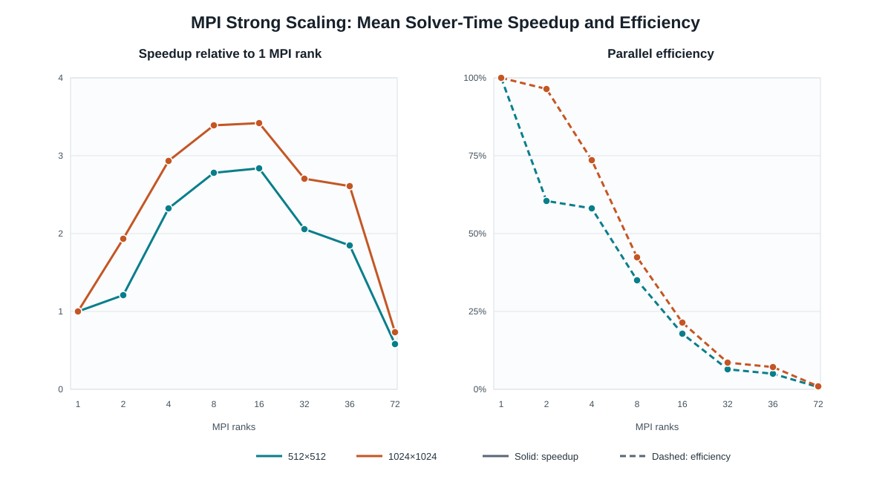

# DSA5208 — Person B Technical Report: Distributed-Memory MPI Conjugate Gradient

- **Scope:** MPI CG implementation, correctness verification, and strong scaling
- **Evidence date:** 24 October 2026
- **Status:** Implementation, Vanda tests, and both scaling campaigns completed

## Abstract

Person B implemented a C++17, double-precision, unpreconditioned distributed-memory Conjugate Gradient (CG) solver on row-partitioned CSR matrices. Distributed sparse matrix-vector multiplication (SpMV) uses `MPI_Allgatherv`, dot products use `MPI_Allreduce`, and convergence is verified with the distributed true residual. MPI libraries, a benchmark runner, three test executables, and PBS jobs integrate into the existing CMake project. The latest Vanda correctness job passed 10/10 CTest targets and all MPI test executables at one, two, and four ranks. Two 2D Poisson scaling jobs each produced 80/80 converged timed runs over eight rank settings. Mean solver-time speedup peaks at 16 ranks (2.8391× for 512×512, 3.4184× for 1024×1024) and reverses at higher ranks.

## 1. Objectives, Scope, and Deliverables

Task B covers CSR row partitioning and vector scatter/gather; distributed SpMV, dot product, and local vector updates; unpreconditioned MPI CG with true-residual verification; MPI CMake targets, correctness tests, CSV benchmarking, and Vanda PBS jobs. The shared Poisson generators already exist in common project code and are reused here; this report does not claim their authorship or Person A's Serial/OpenMP results. The modular `cg_mpi_ops` library can be reused by a hybrid solver, but no hybrid implementation is claimed as a Task B deliverable.

Key files are `include/mpi_partition.hpp`, `include/mpi_ops.hpp`, `include/mpi_solver.hpp`, `include/mpi_benchmark.hpp`, `src/mpi/*.cpp`, `tests/test_mpi_{partition,spmv,cg}.cpp`, MPI sections of `CMakeLists.txt`, and the three PBS scripts in `scripts/vanda/` for tests and the two scaling campaigns.

## 2. Implementation

### 2.1 CSR row partitioning

For N matrix rows and P ranks, `rows_per_rank = ceil(N/P)` and rank r owns `[min(r × rows_per_rank, N), min((r+1) × rows_per_rank, N))`. Rank 0 validates the square input, broadcasts dimensions, extracts CSR row blocks, and sends remote blocks. Local `row_ptr` is rebased to zero; `col_idx` keeps global indices. The partition stores global dimensions and offsets. Scatter/gather utilities support vectors and validation. P > N is rejected. Rank 0 holds the full matrix during distribution, which is outside the timed solve.

### 2.2 Distributed operations

`mpi_csr_matvec` computes Allgatherv counts and displacements from the row offsets, replicates x on every rank, and evaluates local CSR rows. The replicated vector consumes O(N) doubles per rank; vector communication is O(N) per rank per SpMV as an order-of-magnitude description, with actual network traffic dependent on the collective. `mpi_dot` sums local products and calls `MPI_Allreduce(MPI_SUM)`; `mpi_norm2` uses this dot product. Local vector updates complete the recurrence. Allgatherv uses `int` count/displacement arguments, limiting very large cases without additional handling. Sparse halo exchange, communication overlap, and OpenMP local parallelism are not implemented in this MPI variant.

### 2.3 CG solver

The zero initial guess gives initial residual and direction equal to b. Each iteration computes `Ap`, `pᵀAp`, the step length, solution and recursive residual updates, and a new direction. Globally reduced scalars make convergence and breakdown decisions common to all ranks. Once the recursive relative residual reaches the tolerance, the solver forms `b − Ax` with distributed SpMV, checks its global norm, and restarts from the true residual if necessary. It checks invalid numerical quantities collectively and reports a true residual at the iteration limit. Benchmarks use tolerance `1e-8`, at most 10,000 iterations, and manufactured `x* = ones`, `b = Ax*`. The tests below cover exercised matrices and rank counts, not arbitrary SPD systems formally.

## 3. Build and Correctness Verification

The latest correctness job (PBS `1482726.stdct-mgmt-02`, CN-152, 24 October 2026) shows successful MPI-enabled Release configuration and a full build through `run_mpi_benchmark`. **All 10 CTest targets passed**, including `mpi_partition`, `mpi_spmv`, and `mpi_cg` at four ranks. The job then ran each MPI executable with one, two, and four ranks: **all 9 executable/rank combinations passed**. The single-rank MPI-versus-serial CG comparison ran at one rank and is intentionally skipped inside two- and four-rank executions.

| Executable | Source-level coverage | Observed ranks |
|---|---|---|
| `test_mpi_partition` | Single-rank properties; 2D Poisson 16×16 and 32×32 partitions; 81-row nondivisible case; gather/scatter round trip; row integrity; partition validation | 1, 2, 4 passed |
| `test_mpi_spmv` | Distributed versus serial SpMV on 2D 16×16, 2D 32×32, 3D 8×8×8; ones and zero vectors; dot product and norm | 1, 2, 4 passed |
| `test_mpi_cg` | 2D 8×8, 16×16, 32×32; 3D 4³ and 8³; one-rank serial comparison; 16×16 and 32×32 solution checks across separately run rank counts; 81-row case | 1, 2, 4 passed |

CG assertions include convergence, true relative residual at most `1e-8`, and small manufactured-solution error on these test matrices. The routines labelled “cross-rank consistency” check each run against the known solution; they do not directly compare solution vectors from different jobs. Earlier retained jobs contain build/test and launch failures, followed by successful reruns. They are historical troubleshooting records, not the latest verification verdict.

## 4. Experimental Setup and Data Audit

The workloads are 2D Poisson 512×512 (N = 262,144; NNZ = 1,308,672) and 1024×1024 (N = 1,048,576; NNZ = 5,238,784). Each uses P = 1, 2, 4, 8, 16, 32, 36, 72, four untimed warmups, and ten timed repetitions per P. The selected jobs are `1482451.stdct-mgmt-02` and `1482491.stdct-mgmt-02`, respectively. Both allocate two nodes, 36 MPI slots per node, and run `--map-by slot --bind-to core`; the 512 job requests 32 GB per node, the 1024 job 64 GB. Both benchmark logs load `CMake/3.27.6-GCCcore-13.2.0` and `OpenMPI/4.1.6-GCC-13.2.0`, and report GCC 13.2.0. The 1024 log identifies Intel Xeon Platinum 8452Y nodes CN-093/CN-094. The 512 log identifies GN-A40-048/GN-A40-050 but does not establish the CPU model. The correctness script names a 4.1.8 MPI module, while that job's CMake output resolves a 4.1.6 MPI compiler; the benchmark logs independently establish 4.1.6 for both scaling jobs.

The CSV field `solve_seconds` is the maximum rank elapsed time in seconds. After a barrier, `MPI_Wtime` surrounds `solve_mpi_cg`; `MPI_Reduce(MPI_MAX)` selects the slowest rank. Timed work includes local computation and solver collectives. Matrix generation, partitioning, RHS formation, warmups, post-solve solution-error calculation, and CSV writing are excluded. The CSV has no communication-only or total-job timing. `true_relative_residual` and `relative_solution_error` are dimensionless; `iterations` counts CG iterations.

The audit selected only `results/mpi/mpi_2d512_p<P>_1482451.stdct-mgmt-02.csv` and `results/mpi/mpi_2d1024_p<P>_1482491.stdct-mgmt-02.csv`. All 16 files have the expected 12 columns, exactly ten rows with run indices 0–9 once each, complete fields, finite positive solver times, consistent size/rank/NNZ metadata, `solver=mpi`, and `threads=1`. No selected run is missing or duplicated. Other validation files and earlier/partial 512 attempts in the directory are separate experiments and excluded. All selected rows have `converged=1`: **80/80 for each size, 160/160 overall**. Iterations are 894 for every 512 row and 1,755 for every 1024 row. Maximum true relative residuals are about `9.5261e-09` and `9.8021e-09`, below `1e-8`; maximum relative solution errors are about `2.2112e-08` and `4.8189e-08`.

## 5. Statistics and Scaling Results

`T(P)` is the arithmetic mean of the ten `solve_seconds` values. SD is the sample standard deviation (denominator 9). `Speedup(P) = T(1)/T(P)` and `Efficiency(P) = Speedup(P)/P` use only the same matrix and timing field. Ratios were computed before display rounding. Min–max is the observed timed-run range. No serial/OpenMP baseline is included.

### 5.1 512×512 2D Poisson — job 1482451

| Ranks | Converged/runs | Mean s | SD s | Min–max s | Speedup | Efficiency | Iterations |
|---:|---:|---:|---:|---:|---:|---:|---:|
| 1 | 10/10 | 1.803076 | 0.001980 | 1.801473–1.806533 | 1.0000 | 1.0000 | 894 |
| 2 | 10/10 | 1.494327 | 0.044425 | 1.464502–1.618214 | 1.2066 | 0.6033 | 894 |
| 4 | 10/10 | 0.776791 | 0.006629 | 0.770091–0.790760 | 2.3212 | 0.5803 | 894 |
| 8 | 10/10 | 0.647911 | 0.004128 | 0.643622–0.653115 | 2.7829 | 0.3479 | 894 |
| 16 | 10/10 | 0.635083 | 0.004096 | 0.631542–0.642764 | 2.8391 | 0.1774 | 894 |
| 32 | 10/10 | 0.876198 | 0.013568 | 0.850373–0.903760 | 2.0578 | 0.0643 | 894 |
| 36 | 10/10 | 0.978048 | 0.010010 | 0.965682–0.993241 | 1.8435 | 0.0512 | 894 |
| 72 | 10/10 | 3.111284 | 0.013676 | 3.088768–3.136455 | 0.5795 | 0.0080 | 894 |

### 5.2 1024×1024 2D Poisson — job 1482491

| Ranks | Converged/runs | Mean s | SD s | Min–max s | Speedup | Efficiency | Iterations |
|---:|---:|---:|---:|---:|---:|---:|---:|
| 1 | 10/10 | 29.194377 | 0.038686 | 29.133957–29.260419 | 1.0000 | 1.0000 | 1,755 |
| 2 | 10/10 | 15.122517 | 0.014858 | 15.102769–15.140765 | 1.9305 | 0.9653 | 1,755 |
| 4 | 10/10 | 9.944964 | 0.041479 | 9.891228–10.025768 | 2.9356 | 0.7339 | 1,755 |
| 8 | 10/10 | 8.603368 | 0.147283 | 8.219117–8.681642 | 3.3934 | 0.4242 | 1,755 |
| 16 | 10/10 | 8.540302 | 0.013833 | 8.522929–8.565000 | 3.4184 | 0.2137 | 1,755 |
| 32 | 10/10 | 10.781777 | 0.013728 | 10.765208–10.810218 | 2.7078 | 0.0846 | 1,755 |
| 36 | 10/10 | 11.192095 | 0.015402 | 11.172821–11.213291 | 2.6085 | 0.0725 | 1,755 |
| 72 | 10/10 | 40.043157 | 0.169592 | 39.678259–40.236733 | 0.7291 | 0.0101 | 1,755 |

### 5.3 Scaling figure



**Figure 1.** Speedup (solid lines, left panel) is normalized to the mean one-rank `solve_seconds` for the same matrix. Efficiency (dashed lines, right panel) is speedup divided by rank count. Each point uses the arithmetic mean of ten converged timed runs; rank counts are shown on the horizontal axes.

## 6. Performance Analysis

Both sizes improve through 16 ranks in mean solver time, but scaling is not close to linear across the full range. For 512, the mean falls from 1.803076 to 0.635083 s (2.8391×; 17.74% efficiency); for 1024, from 29.194377 to 8.540302 s (3.4184×; 21.37%). The larger workload has higher within-job efficiency at every P > 1, including 96.53% at two ranks versus 60.33% for 512. These dimensionless ratios do not imply identical hardware between jobs.

Figure 1 makes the shared trend visible: both speedup curves peak at 16 ranks, then fall, while efficiency declines as ranks increase. The 1024×1024 case retains more useful scaling through 16 ranks than the 512×512 case, but neither maintains the gain at 32 or 36 ranks. At 72 ranks both speedups fall below 1, so adding ranks is slower than the corresponding one-rank run.

Mean time rises beyond 16 ranks. At 72 ranks, the 512 solve takes 3.111284 s (0.5795× one-rank speedup), and the 1024 solve takes 40.043157 s (0.7291×). The scripts can place up to 36 ranks on one node, while 72 spans two nodes. The marked 36-to-72 increase is consistent with cross-node collective cost, but there are no per-collective timings to isolate it. Constant iteration counts and successful true-residual checks rule out iteration-count changes or failed solves as explanations for these timing trends. Row partitioning may give unequal nonzero counts at boundaries, but rank-level workloads and idle time were not measured. The full-vector Allgatherv and repeated reductions are plausible constraints from code inspection, not separately quantified causes.

## 7. Limitations and Discussion

Evidence covers two structured Poisson matrices, one successful job per size, and ten sequential timed repetitions per rank setting. Within-job SD does not measure between-job, node, or placement variation. The 1024 eight-rank minimum, 8.219117 s, is below the other measurements and raises its SD; this valid record is retained. The 512 two-rank setting also varies more than adjacent configurations. Jobs run rank settings in ascending order, leaving time-dependent cluster effects possible. The 512 CPU model is not established in its retained log, so absolute cross-job times are not treated as a controlled hardware comparison.

The solver replicates a full vector per rank, uses `int` Allgatherv counts/displacements, and has no halo exchange, overlap, or communication-only profiling. The correctness suite exercises representative paths at one, two, and four ranks; the large experiments additionally show convergence to 72 ranks for their two matrices. Neither provides formal proof for arbitrary sparse inputs. 

## 8. Reproduction and Evidence

From the repository root on Vanda, the recorded workflows are:

```bash
qsub scripts/vanda/test_mpi_correctness.pbs
qsub scripts/vanda/benchmark_mpi_scaling.pbs
qsub scripts/vanda/benchmark_mpi_scaling_1024.pbs
```

The PBS jobs `1482726.stdct-mgmt-02` (correctness), `1482451.stdct-mgmt-02` (512×512), and `1482491.stdct-mgmt-02` (1024×1024) provide the build, test, and benchmark records. The 16 selected CSVs in `results/mpi/` provide the per-run measurements used in the tables. The scripts record the module, PBS, and cluster-specific path settings needed to reproduce the workflows.

## 9. Conclusion

Task B's MPI implementation, Vanda build and correctness verification, and both planned Poisson scaling campaigns are complete. The latest CTest is 10/10, every MPI executable passes at one, two, and four ranks, and both experiments have 80/80 converged timed solves. Mean speedup peaks at 16 ranks and reverses at higher counts; 72 ranks is slower than one rank for both matrices. Full-vector Allgatherv and global reductions are credible scaling constraints, while available data do not quantify communication or load imbalance. These conclusions apply to the measured solver-only runs and recorded Vanda conditions.
