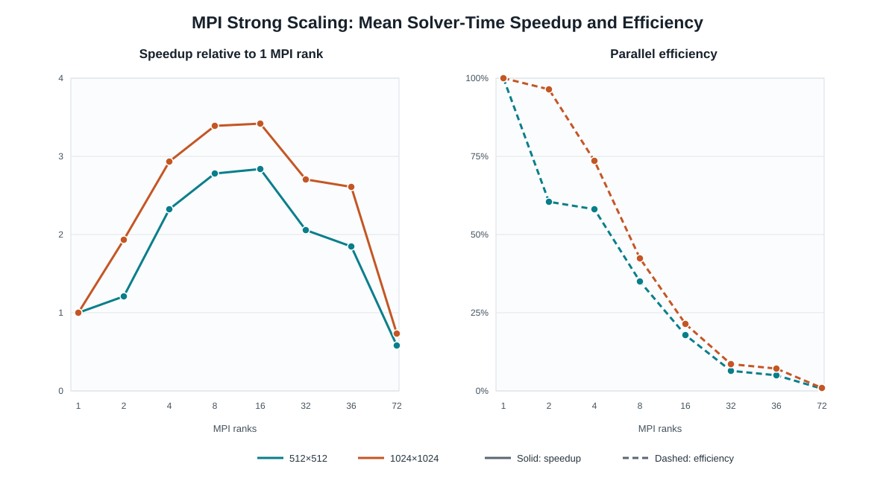
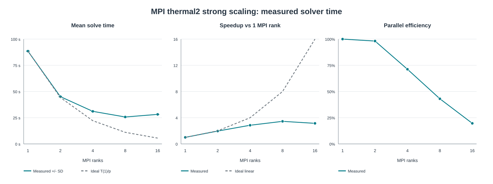
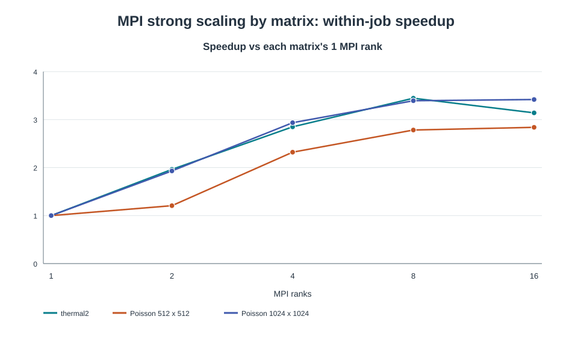

# DSA5208 — Person B 技术报告：分布式内存 MPI 共轭梯度法

- **范围：**MPI 共轭梯度法实现、正确性验证和强扩展实验
- **证据：**Poisson 与正确性作业记录于 2026 年 10 月 24 日；thermal2 PBS 作业为 `1495684.stdct-mgmt-02`；2026 年 10 月 26 日完成本地最终审计
- **状态：**实现、Vanda 测试、两组 Poisson 扩展实验和一组 thermal2 实验均已完成

## 摘要

Person B 基于按行划分的 CSR 矩阵，实现了 C++17 双精度、无预条件的分布式内存共轭梯度法（CG）。分布式稀疏矩阵向量乘法（SpMV）使用 `MPI_Allgatherv`，内积使用 `MPI_Allreduce`，收敛则通过分布式计算的真实残差验证。MPI 库、基准测试程序、三个测试程序以及 PBS 作业已接入现有 CMake 项目。最新 Vanda 正确性作业通过了全部 10 个 CTest 项目，三个 MPI 测试程序分别在 1、2、4 个进程下通过。两组二维 Poisson 扩展实验各涵盖八种进程数，每组 80/80 次计时求解均收敛。按平均求解时间计算，最高加速比都出现在 16 个进程：512×512 为 2.8391 倍，1024×1024 为 3.4184 倍；进程数继续增加后性能下降。另一次 SuiteSparse `thermal2` 实验在 1、2、4、8、16 个进程下有 50/50 次计时求解收敛；8 个进程的平均求解时间最短，为 25.690135 s，相对 MPI 单进程加速 3.4458 倍。

## 1. 目标、负责范围与交付内容

Task B 涵盖 CSR 按行划分和向量散发/汇集、分布式 SpMV 与内积及本地向量更新、带真实残差验证的无预条件 MPI CG、MPI CMake 构建目标、正确性测试、CSV 基准测试，以及 Vanda PBS 作业。共享 Poisson 矩阵生成器已存在于项目公共代码中，本实现复用它；本报告不将其或 Person A 的串行/OpenMP 成果归于 Person B。模块化的 `cg_mpi_ops` 可供混合并行求解器复用，但 Task B 不声称已实现混合求解器。

主要文件包括 `include/mpi_partition.hpp`、`include/mpi_ops.hpp`、`include/mpi_solver.hpp`、`include/mpi_benchmark.hpp`、`src/mpi/*.cpp`、`tests/test_mpi_{partition,spmv,cg}.cpp`、`CMakeLists.txt` 中的 MPI 配置，以及 `scripts/vanda/` 中用于测试和扩展实验的 PBS 脚本。

## 2. 实现

### 2.1 CSR 按行划分

对于 N 行矩阵和 P 个 MPI 进程，`rows_per_rank = ceil(N/P)`，进程 r 负责 `[min(r × rows_per_rank, N), min((r+1) × rows_per_rank, N))`。0 号进程验证方阵输入，通过 `MPI_Bcast` 广播维度，提取 CSR 行块，再通过 `MPI_Send`/`MPI_Recv` 分发。本地 `row_ptr` 从零重新编号；`col_idx` 保留全局列号。划分对象记录全局维度和行偏移。测试使用 `MPI_Scatterv` 和 `MPI_Gatherv` 向量工具；基准程序则通过分布式 SpMV 在本地构造右端项，不汇集最终解。P > N 会被拒绝。分配阶段不计入求解器计时，但基准期间 0 号进程仍保留完整输入矩阵及其本地块。

### 2.2 分布式运算

`mpi_csr_matvec` 根据行偏移计算 Allgatherv 的接收数量和位移，在每个进程上形成完整 x 向量，再计算本地 CSR 行。复制的向量每进程占 O(N) 个双精度数；按数量级描述，每次 SpMV 的向量通信为每进程 O(N)，实际网络流量取决于集合通信实现。`mpi_dot` 汇总本地乘积并调用 `MPI_Allreduce(MPI_SUM)`；`mpi_norm2` 基于该内积。本地向量更新完成 CG 递推。Allgatherv 的数量和位移参数使用 `int`，超大问题需要额外的大计数处理。本 MPI 版本没有实现稀疏 halo 交换、通信与计算重叠或本地 OpenMP 并行。

持久保存的解、右端项、残差和搜索方向向量只包含本地行对应的元素；每次 SpMV 临时分配完整输入向量。通常一次迭代的本地运算量为 O(NNZ_r + N_r)，其中 NNZ_r 和 N_r 分别为本地非零元数与行数，通信时间另计。本地 CSR 与求解器存储量为 O(NNZ_r + N_r + N + P)，0 号进程还保留完整输入 CSR。阻塞式集合通信要求各进程参与，并形成数据依赖，但并非显式 barrier。基准程序在计时前使用 `MPI_Barrier`，计时后使用 `MPI_Reduce(MPI_MAX)`；两者均在求解器计时区间之外。

### 2.3 CG 求解器

标准无预条件 CG 求解实对称正定矩阵的 $Ax=b$：$A=A^T$，且任意非零 $v$ 满足 $v^TAv>0$。生成的 Dirichlet Poisson 矩阵满足这一条件。CSR 验证只检查任意导入矩阵的尺寸和存储结构，并不检查其对称性或正定性。`thermal2` 文件采用对称存储，加载后重建对称矩阵；本审计没有独立证明其正定性或条件数。对构造右端项成功求解也不能证明正定性。

实现采用 $x_0=0$、$r_0=b-Ax_0=b$ 和 $p_0=r_0$。记 $\rho_k=r_k^Tr_k$，常规迭代为

$$
q_k=Ap_k,\qquad \alpha_k=\frac{\rho_k}{p_k^Tq_k},\qquad
x_{k+1}=x_k+\alpha_kp_k,\qquad r_{k+1}=r_k-\alpha_kq_k,
$$

$$
\rho_{k+1}=r_{k+1}^Tr_{k+1},\qquad
\beta_k=\frac{\rho_{k+1}}{\rho_k},\qquad
p_{k+1}=r_{k+1}+\beta_kp_k.
$$

全局规约得到的标量使各进程作出一致的收敛和异常判断；求解器不另行广播判断标志。当 $\sqrt{\rho_{k+1}}/\lVert b\rVert_2$ 达到容差时，求解器额外执行一次分布式 SpMV 计算真实残差 $b-Ax_{k+1}$，仅在 $\lVert b-Ax_{k+1}\rVert_2/\lVert b\rVert_2\leq 10^{-8}$ 时接受收敛。否则以真实残差替换递推残差并重启搜索方向，这是常规递推之外的数值防护。零右端项直接返回精确零解，报告残差为零。`pᵀAp` 非正及若干非有限标量会触发异常检查；达到迭代上限时也会报告真实残差。基准实验最多允许 10,000 次迭代，构造 `x* = ones`、`b = Ax*`。解误差指标为 $\lVert x-x^*\rVert_2/\lVert x^*\rVert_2$，与停止准则使用的残差不同。双精度、真实残差验证和重启有助于降低残差漂移风险，但不能保证所有条件数或数值范围下的准确性。

## 3. 构建与正确性验证

最新正确性作业（PBS `1482726.stdct-mgmt-02`，CN-152，2026 年 10 月 24 日）显示启用 MPI 的 Release 配置成功，并完整构建到 `run_mpi_benchmark`。**10/10 个 CTest 项目通过**，其中 `mpi_partition`、`mpi_spmv`、`mpi_cg` 在 4 个进程下执行。随后作业分别以 1、2、4 个进程运行三个 MPI 测试程序：**9/9 个“程序×进程数”组合通过**。MPI 与串行 CG 的比较实际在单进程时执行；在双进程和四进程的测试程序内部按设计跳过。

| 测试程序 | 源码中的覆盖内容 | 实测进程数 |
|---|---|---|
| `test_mpi_partition` | 单进程特性；二维 Poisson 16×16、32×32 划分；81 行不能整除的情形；散发/汇集往返；行数据完整性；划分验证 | 1、2、4 均通过 |
| `test_mpi_spmv` | 二维 16×16、二维 32×32、三维 8×8×8 的分布式与串行 SpMV 比较；全 1 和全 0 向量；内积与范数 | 1、2、4 均通过 |
| `test_mpi_cg` | 二维 8×8、16×16、32×32；三维 4³、8³；单进程与串行比较；分别运行的进程配置中 16×16、32×32 解的检查；81 行情形 | 1、2、4 均通过 |

CG 检查包括收敛、真实相对残差不超过 `1e-8`，以及二维/三维解测试中的人为构造相对解误差小于 `1e-4`。SpMV 与串行结果比较采用 `|a-b| <= 1e-9*(1+|a|+|b|)`；单进程 CG 比较采用相同形式、系数为 `1e-12`，并要求迭代次数相同。MPI 测试使用自定义 `CHECK`，失败时调用 `MPI_Abort`，Release 构建中仍会执行。源码中标为“cross-rank consistency”的函数检查每次运行与已知解的接近程度，并不直接比较不同作业保存的解向量。本地保留的较早作业曾发生构建/测试和启动失败，之后已有成功重跑；它们属于历史排障记录，不代表最新验证结论。

`CMakeLists.txt` 要求 C++17、CMake 至少 3.20，且本项目的 MPI 构建仍要求 OpenMP。MPI 目标取决于 `CG_ENABLE_MPI` 和是否找到 C++ MPI 库；`cg_mpi_ops` 链接 `MPI::MPI_CXX`，`cg_mpi` 加入求解器，`cg_mpi_benchmark` 加入计时和 CSV 输出。`run_mpi_benchmark` 还链接共享的 Poisson 生成器与 Matrix Market 加载器。CTest 注册的三个 MPI 测试各使用 4 个进程；默认的 `matrix_market` 测试使用小型夹具，并不运行可选的完整 thermal2 集成测试。

## 4. 实验环境与数据审计

实验矩阵为二维 Poisson 512×512（N = 262,144；NNZ = 1,308,672）和 1024×1024（N = 1,048,576；NNZ = 5,238,784）。每种矩阵分别使用 P = 1、2、4、8、16、32、36、72，每种 P 先做 4 次不计时预热，再做 10 次计时。选取的作业分别为 `1482451.stdct-mgmt-02` 和 `1482491.stdct-mgmt-02`。两份脚本都申请两台节点、每台 36 个 MPI 槽位，并指定 `--map-by slot --bind-to core`；512 作业每节点申请 32 GB，1024 作业每节点申请 64 GB。两份基准日志均显示已加载 `CMake/3.27.6-GCCcore-13.2.0` 和 `OpenMPI/4.1.6-GCC-13.2.0`。1024 日志还打印 GCC 13.2.0，列出 CN-093/CN-094 节点，并报告启动主机 CN-093 使用 Intel Xeon Platinum 8452Y。512 日志列出 GN-A40-048/GN-A40-050，但未打印编译器版本或 CPU 型号；GCC 13.2.0 由所加载的工具链模块名称识别。资源申请和启动参数有记录，但日志都没有进程到节点的映射。正确性脚本写有 MPI 4.1.8 模块命令，但该作业的 CMake 输出解析到 4.1.6 MPI 编译器；两份扩展实验日志各自确认 OpenMPI 4.1.6 环境。

CSV 的 `solve_seconds` 是各进程耗时最大值，单位为秒。MPI barrier 后，`MPI_Wtime` 包围 `solve_mpi_cg`，由 `MPI_Reduce(MPI_MAX)` 取最慢进程时间。计时包含本地计算和求解器内的 MPI 集合通信，不包含矩阵生成、划分、右端项构造、预热、求解后的解误差计算及 CSV 写入。CSV 没有单独的通信时间或整个作业耗时。`true_relative_residual` 和 `relative_solution_error` 无量纲；`iterations` 是 CG 迭代次数。

数据审计只选取 `results/mpi/mpi_2d512_p<P>_1482451.stdct-mgmt-02.csv` 和 `results/mpi/mpi_2d1024_p<P>_1482491.stdct-mgmt-02.csv`。16 份文件均有预期的 12 列，每份恰有 10 行，`run_index` 0–9 各出现一次，字段完整，求解时间有限且为正，矩阵规模、进程数、NNZ 等元数据一致，`solver=mpi`、`threads=1`。选定作业内没有缺失或重复的计时记录。目录里的其他验证文件及更早/不完整的 512 实验属于独立尝试，不计入本分析。选定数据的每行均为 `converged=1`：**每种规模 80/80，两种规模合计 160/160**。512 的所有记录都是 894 次迭代，1024 都是 1,755 次。最大真实相对残差约为 `9.5261e-09` 和 `9.8021e-09`，均低于 `1e-8`；最大相对解误差约为 `2.2112e-08` 和 `4.8189e-08`。

另一个输入是 SuiteSparse `Schmid/thermal2` 非结构化有限元稳态热问题矩阵，身份及应用描述见本地 Matrix Market 文件头。对称坐标格式加载后展开为 CSR（N = 1,228,045；NNZ = 8,580,313）；加载器镜像非对角元素并合并重复项。与 Person A 的实验一样，基准程序**不使用**随数据提供的 `thermal2_b.mtx`，而是构造 `x* = ones` 和 `b = Ax*`，以便测量解误差。`benchmark_mpi_thermal2.pbs` 脚本申请两台节点，每节点 36 个 CPU、36 个 MPI 槽位和 64 GB 内存，共 72 个 CPU 任务槽位，PBS walltime 上限为 8 小时。这些申请资源和时间上限不同于实际启动的 1–16 个进程及求解器计时。两节点申请与 PBS `Exit_status: 0` 是提供的实验背景；执行日志中没有保留调度器核算记录。

保留的 `results/mpi/thermal2/dsa5208_mpi_thermal2.o1495684` 日志确认加载 CMake/GCC 13.2.0 与 OpenMPI 4.1.6 模块，CMake 发现 4.1.6 的 `mpicxx` 路径，且成功配置并构建 `run_mpi_benchmark`。日志依次记录 P = 1、2、4、8、16。当前脚本要求 Release 构建，但日志未回显构建类型参数，也没有归档 CMake 缓存。每组均报告相应的矩阵维度和进程数、4 次预热、10 次计时、对应 CSV 路径及 `Converged: 10/10`。程序参数 `10` 与 `4` 分别表示计时重复次数和预热次数，已由入口参数解析核对。五组日志中位数与 CSV 在日志显示精度内一致。日志中的迭代次数与残差来自每组第一条记录，并非汇总统计；CSV 全部记录已另行检查。

每次启动前，OpenMPI 都报告 `mca_plm_tm` 和 `mca_ras_tm` 无法加载 `libpbs.so.0`，并明确标为 `(ignored)`；五次启动共十条组件警告。日志中没有致命应用错误、abort 或未收敛提示；包括 16 进程在内的五组都写出 CSV 并完成摘要。警告的性能影响及备用启动机制未获验证。`CN-115` 前缀仅标识发出警告的主机，不是求解进程映射。日志没有进程到节点或绑定信息，因此无法确定进程分布在一台还是两台节点上。

历史命令与当前脚本存在路径差异：日志加载 `data/thermal2/thermal2.mtx`，当前 PBS 脚本设置 `MATRIX="data/suitesparse/thermal2/thermal2.mtx"`。所以当前脚本是复现方案，不是提交时脚本的逐字归档。矩阵维度、进程顺序、输出文件名、预热和重复次数则与 CSV 及当前代码一致。

五份 `results/mpi/thermal2/thermal2_p<P>_1495684.stdct-mgmt-02.csv` 各有十条逐次测量，而非汇总行或混合配置。表头为 `solver,matrix_name,n,nnz,ranks,threads,run_index,iterations,converged,solve_seconds,true_relative_residual,relative_solution_error`。50 条记录字段完整，每份文件的 `run_index` 0–9 各一次，矩阵和进程元数据一致，`solver=mpi`、`threads=1`，求解时间有限且为正。全部记录均为 `converged=1`，真实相对残差小于 `1e-8`。CSV 记录的是**相对**真实残差和相对解误差，不是最终绝对残差范数。PBS 零退出状态本身不足以证明这些数值检查。

## 5. 统计方法与扩展结果

`T(P)` 是同一进程配置下 10 个 `solve_seconds` 值的算术平均数。SD 为样本标准差（分母为 9）。`Speedup(P) = T(1)/T(P)`，效率比例 `E(P) = Speedup(P)/P`，百分比为 `100*E(P)`；只在相同矩阵、相同计时字段内计算。5.1–5.2 节的效率以比例表示，5.4 节以百分比表示。所有比值均先用未舍入的均值计算，再按表格精度显示。最小值—最大值为计时记录的实际范围。计算中没有使用串行/OpenMP 基线。

### 5.1 512×512 二维 Poisson — 作业 1482451

| 进程数 | 收敛/次数 | 均值 s | SD s | 最小—最大 s | 加速比 | 并行效率（比例） | 迭代次数 |
|---:|---:|---:|---:|---:|---:|---:|---:|
| 1 | 10/10 | 1.803076 | 0.001980 | 1.801473–1.806533 | 1.0000 | 1.0000 | 894 |
| 2 | 10/10 | 1.494327 | 0.044425 | 1.464502–1.618214 | 1.2066 | 0.6033 | 894 |
| 4 | 10/10 | 0.776791 | 0.006629 | 0.770091–0.790760 | 2.3212 | 0.5803 | 894 |
| 8 | 10/10 | 0.647911 | 0.004128 | 0.643622–0.653115 | 2.7829 | 0.3479 | 894 |
| 16 | 10/10 | 0.635083 | 0.004096 | 0.631542–0.642764 | 2.8391 | 0.1774 | 894 |
| 32 | 10/10 | 0.876198 | 0.013568 | 0.850373–0.903760 | 2.0578 | 0.0643 | 894 |
| 36 | 10/10 | 0.978048 | 0.010010 | 0.965682–0.993241 | 1.8435 | 0.0512 | 894 |
| 72 | 10/10 | 3.111284 | 0.013676 | 3.088768–3.136455 | 0.5795 | 0.0080 | 894 |

### 5.2 1024×1024 二维 Poisson — 作业 1482491

| 进程数 | 收敛/次数 | 均值 s | SD s | 最小—最大 s | 加速比 | 并行效率（比例） | 迭代次数 |
|---:|---:|---:|---:|---:|---:|---:|---:|
| 1 | 10/10 | 29.194377 | 0.038686 | 29.133957–29.260419 | 1.0000 | 1.0000 | 1,755 |
| 2 | 10/10 | 15.122517 | 0.014858 | 15.102769–15.140765 | 1.9305 | 0.9653 | 1,755 |
| 4 | 10/10 | 9.944964 | 0.041479 | 9.891228–10.025768 | 2.9356 | 0.7339 | 1,755 |
| 8 | 10/10 | 8.603368 | 0.147283 | 8.219117–8.681642 | 3.3934 | 0.4242 | 1,755 |
| 16 | 10/10 | 8.540302 | 0.013833 | 8.522929–8.565000 | 3.4184 | 0.2137 | 1,755 |
| 32 | 10/10 | 10.781777 | 0.013728 | 10.765208–10.810218 | 2.7078 | 0.0846 | 1,755 |
| 36 | 10/10 | 11.192095 | 0.015402 | 11.172821–11.213291 | 2.6085 | 0.0725 | 1,755 |
| 72 | 10/10 | 40.043157 | 0.169592 | 39.678259–40.236733 | 0.7291 | 0.0101 | 1,755 |

### 5.3 扩展性图表



**图 1。** 左图实线为加速比，以同一矩阵单进程 `solve_seconds` 的平均值为基准；右图虚线为并行效率，即加速比除以进程数，以百分比显示。每个数据点均使用 10 次已收敛计时运行的算术平均值。三张图的测试进程数都在横轴等间距的分类位置显示；图上的水平距离不代表进程数差值成比例。

### 5.4 SuiteSparse thermal2 — 作业 1495684

沿用上述 `T(P)`、样本 SD、加速比和效率定义。这里的 `T(1)` 是 **MPI 单进程**，并非独立测得的串行求解器。最小—最大值和中位数均基于每份 CSV 的十个 `solve_seconds`。残差及解误差列是十次运行中的最大值；每个进程配置内部迭代次数不变。

| 进程数 | 收敛/次数 | 均值 s | SD s | 中位数 s | 最小—最大 s | 加速比 | 并行效率（%） | 迭代次数 | 最大真实相对残差 | 最大相对解误差 |
|---:|---:|---:|---:|---:|---:|---:|---:|---:|---:|---:|
| 1 | 10/10 | 88.523455 | 0.253923 | 88.526741 | 88.175257–89.022706 | 1.0000 | 100.00% | 4,333 | 9.860597e-09 | 4.412101e-07 |
| 2 | 10/10 | 45.098825 | 0.268347 | 45.098867 | 44.764948–45.386621 | 1.9629 | 98.14% | 4,333 | 9.843217e-09 | 4.410869e-07 |
| 4 | 10/10 | 31.069230 | 0.143527 | 31.098854 | 30.771459–31.217149 | 2.8492 | 71.23% | 4,332 | 9.965738e-09 | 4.418496e-07 |
| 8 | 10/10 | **25.690135** | 0.008274 | 25.691592 | 25.678339–25.701494 | **3.4458** | 43.07% | 4,331 | 9.986189e-09 | 4.429738e-07 |
| 16 | 10/10 | 28.187397 | 0.014522 | 28.182656 | 28.163636–28.209606 | 3.1405 | 19.63% | 4,332 | 9.937960e-09 | 4.412162e-07 |



**图 2。** 展示最慢进程平均求解时间及样本 SD 误差条、相对 MPI 单进程均值的实测加速比和理想线性加速比、并行效率。理想时间为 `T(1)/P`。相对于时间轴范围，SD 误差条较小；准确数值见表格。`solve_seconds` 不含矩阵加载与分发、右端项构造、预热、精度计算和 CSV 输出。



**图 3。** 各矩阵的平均求解时间分别以其**自身作业中的 MPI 单进程均值**归一化，仅显示共同测试的 1–16 个进程。该图可比较扩展比值，但不意味着不同作业的绝对耗时或硬件条件相同。

## 6. 性能分析

两种规模的平均求解时间都在增加到 16 个进程时改善，但在整个测试区间内均不能称为接近线性扩展。512 的均值从 1.803076 s 降至 0.635083 s（2.8391 倍；效率 17.74%）；1024 从 29.194377 s 降至 8.540302 s（3.4184 倍；效率 21.37%）。在每个 P > 1 的配置下，大规模问题的作业内效率较高，例如两个进程时为 96.53%，而 512 为 60.33%。这些无量纲比值并不意味着两组作业使用了完全相同的硬件。

图 1 直观展示了两组实验的共同趋势：加速比曲线都在 16 个进程达到峰值，之后下降；并行效率随进程数增加而降低。1024×1024 矩阵在达到 16 个进程前保留了比 512×512 更高的有效扩展性，但两种规模在 32 或 36 个进程时都无法维持先前的加速收益。72 个进程时两组加速比都低于 1，因此增加进程反而慢于对应的单进程运行。

超过 16 个进程后，平均时间上升。72 个进程时，512 耗时 3.111284 s（相对单进程加速比 0.5795），1024 耗时 40.043157 s（0.7291）。Poisson 脚本提供两台节点各 36 槽位的 hostfile，并请求槽位映射和核心绑定。这记录了预期的启动策略，但日志没有明确的进程映射，因此不能断言实际节点占用。36 到 72 个进程的时间增加与集合通信及同步成本增加相容；按预期策略，跨节点影响也有可能，但未获验证。同一矩阵的迭代次数固定，真实残差检查全部通过，因此这些时间变化不是由迭代次数变化或求解失败造成的。按行划分可能使边界处的非零元数不同，但实验没有测量各进程工作量或空等时间。完整向量 Allgatherv 与重复全局规约是基于代码的合理扩展性约束推断，不是已单独量化的原因。

对于 `thermal2`，平均求解时间从单进程的 88.523455 s 降至 8 进程的 25.690135 s，16 进程又升至 28.187397 s，比 8 进程均值高 9.72%。8 进程是已测试配置中的最快值，加速比为 3.4458，低于理想的 8 倍。除单进程基准外，2 进程效率最高，为 98.14%；8 和 16 进程分别降至 43.07% 和 19.63%。全部运行收敛至 `1e-8` 真实相对残差容差以内。迭代次数在 4,331–4,333 之间：16 进程比 8 进程多一次（4,332 对 4,331，增加 0.023%）。若每次迭代成本相同，这一差异远小于 9.72% 的耗时增加；但残差复核及重启次数未记录，不能据此完全控制工作量。各配置的相对解误差约为 `4.4e-07`。微小的迭代和残差差异与浮点规约顺序不同相容，具体原因未测量。

在共同的进程数中，`thermal2` 在 8 进程的加速比 3.4458 高于两种 Poisson 矩阵的 2.7829 和 3.3934；在 16 进程的 3.1405 则位于两者的 2.8391 与 3.4184 之间。这只是样本均值的描述性比较，并非统计显著性结论。`thermal2` 曲线在测试范围内于 8 进程达到峰值，两种 Poisson 的样本均值则继续改善到 16 进程。Poisson 矩阵来自规则五点模板，每行约五个非零元；`thermal2` 是非结构化有限元矩阵，平均每行约 6.99 个非零元，所需迭代次数也明显更多。本实验未分析其逐行非零元分布或跨进程依赖。不同稀疏模式可能改变本地 SpMV 工作量与内存访问，但本实现无论稀疏模式如何，均汇集完整的 N 元素输入向量。数据不能区分何种因素造成曲线差异。作业分别执行，实际进程部署也未知，因此只能比较各作业内的比值，不能视为只改变矩阵的受控实验。

每次 CG 迭代通过 `MPI_Allgatherv` 完整复制输入向量，并执行多次标量 `MPI_Allreduce`。本地行数减少时，这些集合通信和同步可能占据更大时间比例；按行数划分也可能使非零元工作量不均。它们是与次线性加速及 16 进程性能回落相容的源码层面解释。CSV 没有集合通信分项计时、逐进程工作量或部署记录，因此不能量化通信与负载不均衡，也不能归因于跨节点效应。

## 7. 局限与讨论

证据只覆盖两种结构化 Poisson 矩阵、每种规模一个成功作业，以及每个进程配置连续进行的 10 次计时。作业内 SD 不能表示不同作业、节点或进程布局之间的不确定性。1024 在 8 个进程时的最小值 8.219117 s 低于其余测量，使 SD 增大；该有效记录被保留。512 的双进程配置也比相邻配置波动更大。作业按进程数递增顺序运行，因此不能排除随时间变化的集群因素。512 作业日志未确认 CPU 型号，故不将两组绝对时间视为受控的硬件对比。

`thermal2` 的证据来自一个完成的基准作业，依次测试五种进程配置，每组十次计时，并由执行日志和五份 CSV 共同支持。日志记录了模块加载和构建完成，启动警告带有 `CN-115` 前缀，但没有进程映射、CPU 型号、作业总耗时或调度器退出状态。PBS `Exit_status: 0` 仍属于用户提供的背景。两节点资源申请和最多 16 个进程都不能证明实际运行仅用一台或跨两台节点。样本 SD 只描述配置内的重复计时，不代表独立作业或节点间差异。结果排除了矩阵加载和分发，因此反映求解器强扩展，而非端到端应用耗时。本次 MPI 实验没有保存 thermal2 解向量，也没有独立参考求解器结果；数值验证依靠已知的人为构造解和分布式真实残差。

求解器每进程复制完整向量，Allgatherv 使用 `int` 数量/位移，且没有 halo 交换、通信重叠或单独的通信性能分析。正确性测试在 1、2、4 个进程下覆盖有代表性的路径；Poisson 大规模实验显示这两种矩阵在最多 72 个进程下收敛，thermal2 CSV 显示最多 16 个进程下收敛。这些证据都不是对任意稀疏输入的形式化正确性证明。

实际测试范围以外还有源码层面的限制。`std::size_t` 元数据以 `MPI_UNSIGNED_LONG` 传送，符合预期的 LP64 Linux 环境，但并非适用于所有 ABI。向上取整的块划分即使 P <= N 也可能产生末尾空分区（例如 N = 5、P = 4）；当部分进程没有本地元素时，基准程序按本地解非空与否有条件地执行解误差规约，存在集合调用不一致的风险。本报告审查的实验均没有空分区。求解器的标量检查以集合方式进行，但部分划分或加载错误可能在 0 号或个别进程上先抛出异常，而其他进程仍等待集合通信；尚未证明所有输入错误都能一致恢复。因此不声称支持可移植的大计数、任意进程数下的安全性或所有错误情形的集体恢复。

## 8. 复现方法与证据

在 Vanda 的仓库根目录，已记录的工作流程为：

```bash
qsub scripts/vanda/test_mpi_correctness.pbs
qsub scripts/vanda/benchmark_mpi_scaling.pbs
qsub scripts/vanda/benchmark_mpi_scaling_1024.pbs
qsub scripts/vanda/benchmark_mpi_thermal2.pbs
```

PBS 作业 `1482726.stdct-mgmt-02`（正确性）、`1482451.stdct-mgmt-02`（512×512）和 `1482491.stdct-mgmt-02`（1024×1024）提供构建、测试与基准记录。`results/mpi/` 中选定的 16 份 CSV 提供表格所用的逐次测量值。脚本记录了复现实验所需的模块、PBS 配置和集群专用路径。

`thermal2` 测量与执行日志保存在 `results/mpi/thermal2/`，作业号为 `1495684.stdct-mgmt-02`。日志中的命令加载 `data/thermal2/thermal2.mtx`，该文件也是当前本地系数矩阵路径。使用当前 PBS 脚本复现前，需将同一数据集放在脚本指定的 `data/suitesparse/thermal2/thermal2.mtx`。不使用 `thermal2_b.mtx`。在已分配的 Vanda 计算环境中，显式构建与单个进程配置的命令为：

```bash
module load CMake/3.27.6-GCCcore-13.2.0
module load OpenMPI/4.1.6-GCC-13.2.0
cmake -S . -B build -DCMAKE_BUILD_TYPE=Release -DCG_ENABLE_MPI=ON
cmake --build build --parallel 8 --target run_mpi_benchmark
mpirun -np 8 ./build/run_mpi_benchmark thermal2 data/thermal2/thermal2.mtx 10 results/mpi/thermal2/thermal2_p8_reproduction.csv 4
```

每次复现实验应使用新的输出文件名，因为 CSV 写入会截断同名旧文件。这些是复现说明；本次审计未提交新 HPC 作业或执行求解器基准。当前正确性脚本请求 4.1.8 MPI 模块，但历史构建缓存解析到 4.1.6；复现时应使用一致的 MPI 编译器与运行环境，并采用全新构建目录。历史 Poisson 和正确性脚本中的账户及 scratch 路径也需适配。缺少提交时脚本快照、二进制哈希和历史 CMake 缓存，无法完全追溯每次作业的确切源码与构建状态。

执行 `python scripts/analyze_mpi_thermal2.py` 可重算 thermal2 统计并重新生成图 2、图 3；执行 `python scripts/validate_task_b_report.py` 可检查 21 份选定 CSV、两版报告的数值表及共同的图、公式和命令、thermal2 执行日志及图片路径。两个脚本均从仓库路径定位输入。图 1 是保留并已审计的独立 SVG，原绘图脚本不可用。

来源说明：CG 公式参考 Y. Saad，*Iterative Methods for Sparse Linear Systems*，第二版，SIAM，2003；`src/common/poisson.cpp` 亦引用此书。MPI 例程名称及语义参考 [MPI Forum 标准](https://www.mpi-forum.org/docs/)。数据集身份及应用描述来自 `data/thermal2/thermal2.mtx` 文件头；另见 [SuiteSparse Schmid/thermal2 页面](https://sparse.tamu.edu/Schmid/thermal2) 与 `scripts/download_thermal2.ps1` 中的归档地址。上述环境信息取自相应保留作业的日志，不把较早的 `docs/ENVIRONMENT.md` 视为所有作业的环境证据。本地审计未检查外部链接可用性。

## 9. 结论

Task B 的 MPI 实现、Vanda 构建与正确性验证、两组 Poisson 扩展实验和真实矩阵 `thermal2` 实验均已完成。最新 CTest 结果为 10/10；两组 Poisson 实验各有 80/80 次计时求解收敛，`thermal2` 为 50/50。Poisson 平均加速比在 16 个进程达到峰值；已测 `thermal2` 最短平均求解时间出现在 8 个进程，相对 MPI 单进程加速 3.4458 倍，16 进程反而较慢。完整向量 Allgatherv 与全局规约是可信的扩展性约束，但现有数据不能量化通信、负载不均衡或 thermal2 作业的节点部署影响。这些结论仅适用于所测求解器计时和已有条件记录。
